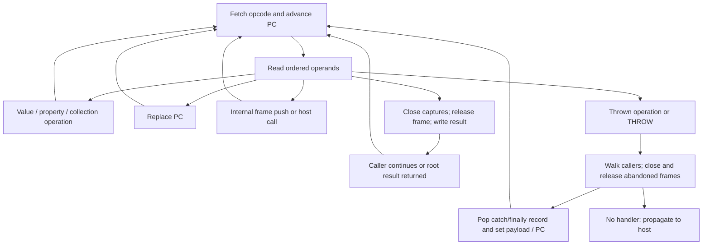

# Canonical instruction set

## 1. Target

The virtual program preserves the effects of supported JavaScript lowering by shipping instructions
and matching handlers. This specification defines each canonical instruction's serialized grammar
and consequential execution decisions at the pinned `0.1.5` source. It is a source-derived contract,
not an exhaustive syntax or optional-stack verification claim.

Readers need JavaScript values, calls, lexical captures, properties and exception completion, plus
[the package prerequisites](js-confuser-vm.md#prerequisites-and-scope). The
[container contract](container-wordcode.md#3-implementation) owns symbolic operand resolution,
register allocation, word transport, frame layout, argument placement and capture-cell storage.
This page owns what instructions do with those interfaces. A reader can derive bounded grammar,
interpreter-handler and compiler-facing completion units from these two contracts. Full source-AST
lowering and detailed optional mechanisms remain outside that claim.

The table uses `OP_ORIGINAL` numbers. Opcode-value randomization at compiler construction changes
those numbers and matching runtime maps. `shuffleOpcodes` later permutes switch-case order; it does
not remap numbers. Added-opcode grammars and handler construction are owned by
[aliases](transforms/aliased-opcodes.md), [macros](transforms/macro-opcodes.md),
[specialized tuples](transforms/specialized-opcodes.md) and
[anti-instrumentation](transforms/anti-instrumentation.md). Their widths and terminal decisions
must not be inferred from canonical rows alone. PATCH is an optional hardening operation with
a fixed canonical header;
its separate encrypted regions are not ordinary instruction streams.

## 2. Algorithm

Lowering evaluates expressions into register values, then emits instructions referring to those
registers. Local storage and captures retain identity through allocation; constant names/values
become pool-index/key pairs, while labels become absolute word PCs. The runtime therefore reads
operands as addresses or indexes, rather than repeating source name resolution on every step.

Dispatch fetches an opcode, advances that frame's PC past it, and lets the handler consume its
operands in order. Most handlers compute or mutate a value and leave PC just after the instruction.
Branches replace PC after reading all branch operands. Calls finish reading arguments before
switching to a new frame or invoking a host callable. RETURN transfers a value only after closing
captures and releasing the callee. An exception uses the current caller chain to find the nearest
armed handler; the compiler supplies continuation instructions for normal and abrupt finalizer exits.



The diagram's exception edge applies to any throwing handler operation, including host calls and
property access. It is not limited to THROW. RETURN itself does not invoke a finalizer: compiler
routing must send pending completion through finalizer code before it reaches RETURN.

### Worked example: capture, call and return

This **synthetic assembly** models `var x = 7; var f = function(){ return x; }; return f();`.
It omits source lowering prologues, reserved locals, implicit returns and hardening. It is not
asserted to be the exact compiler output. Main has three registers; the child has one, no parameters,
no rest parameter and one captured local. There are no pool operands in this example.

| PC | Final words | Meaning |
|---:|---|---|
| 0 | `[1,0,7]` | LOAD_INT puts 7 in main r0; next PC 3. |
| 3 | `[47,1,18,0,1,1,0,1,0]` | MAKE_CLOSURE writes shell to main r1. Child entry 18, params 0, regs 1, upvalues 1, rest 0; `(1,0)` captures main r0. Next PC 12. |
| 12 | `[42,2,1,0]` | CALL uses r1, zero arguments, destination r2; caller PC becomes 16 before child push. |
| 16 | `[45,2]` | Main RETURN transfers r2 to the host result. |
| 18 | `[3,0,0]` | Child LOAD_UPVALUE puts capture 0's value in child r0; next 21. |
| 21 | `[45,0]` | Child RETURN transfers r0 to main r2. |

The stream has `3 + 9 + 4 + 2 + 3 + 2 = 23` words. Under the plain frame layout, main is
at `fp=1`, its r0 address is 9 and its frame ends at 12. The capture cell points to address 9.
CALL pushes the child at `fp=12`, register base 20, size 9, caller 1, return encoding `2<<1=4`
and receiver `globals`. Child argument placement first writes its empty args array at r0; the
LOAD_UPVALUE then replaces it with 7. Child RETURN closes only captures of its own register window,
clears `[12,21)`, restores main and writes main r2 (absolute address 11). Main RETURN closes
its capture cell with value 7, clears `[1,12)` and writes slot zero. Fetch PCs are
`0,3,12,18,21,16`; `VM.run` returns 7. The generated boot normally discards that return value.

This example checks inline descriptor width, distinct register areas, capture sharing and return
ordering. It does not test host calls, mutation after capture, exceptions or optional combinations.

## 3. Implementation

### Components and execution vocabulary

| Component | Consumes -> produces | Required interface |
|---|---|---|
| Grammar reader / emitter | Canonical operation and operands -> complete ordered word span | Width counts operand words below; total width adds one opcode. Counts delimit variable tails. |
| Value and object handlers | Register values / constant pair -> register result or mutation | Preserve actual JavaScript coercion and evaluation effects stated below. |
| Call/completion handler | Callee, args, receiver, destination -> host result or linked frame | Caller PC already consumed; use container frame/argument contract and tagged return encoding. |
| Closure handler | Inline descriptor and capture pairs -> callable shell / shared cells | Local index addresses creating frame; non-local index selects creating closure's upvalue. |
| Region compiler | Protected source region and abrupt action -> handler records / continuation pads | Every crossed record is disarmed or consumed once; pending payload survives finalizer. |
| Unwind handler | Thrown value and caller chain -> nearest handler or host throw | Close captures before abandoning frames; handler itself is popped before entry. |
| PATCH handler | Header and mutable word stream -> overwritten word interval | Reads source words in ascending order, with the exact u32 keystream below. |

Use `R[r] = regs[REG_BASE+r]`, `C[i]` for the pool, `U[i]` for the current closure's upvalue,
and `P` for the current frame's absolute word PC. `read()` is `_operand()`: return `bytecode[P]`
then increment `P`. `K()` consumes `(constIdx,concealKey)` in that order. Key zero returns the
pool entry directly. Nonzero-key materialization and pair production are specified by the
[keyed constant contract](transforms/keyed-constants.md).
`dst/src/obj/key/val/callee/receiver/iter` are register indexes unless the
grammar explicitly says otherwise. `uvIdx` is an upvalue index; PCs and count/flag/immediate words
are numeric operands, not registers. `hasRest` and `isLocal` are emitted as 0/1; runtime tests their
truthiness without a flag-domain assertion.

Operand words are u32, but register **values** are JavaScript values. The
[container numeric/serialization contract](container-wordcode.md#word-addresses-and-serialization)
controls word packing and validation. It does not imply that arithmetic wraps all values to u32.
Successful non-control handlers leave `P = instructionPc + 1 + operandWidth`; explicit branch,
call, return, exception and PATCH effects below override or supplement that rule.

### Canonical grammar

| Opcode | Name | Semantic family | Symbolic IR operands | Serialized words after `op` | Width | Class |
|---:|---|---|---|---|---:|---|
| 0 | `LOAD_CONST` | literal/constant load | `dst, constant(value)` | `dst, constIdx, concealKey` | 3 | core |
| 1 | `LOAD_INT` | immediate/PC seed | `dst, number or label` | `dst, u32` | 2 | core |
| 2 | `LOAD_GLOBAL` | global resolution | `dst, constant(name)` | `dst, constIdx, concealKey` | 3 | core |
| 3 | `LOAD_UPVALUE` | closure state | `dst, uvIdx` | `dst, uvIdx` | 2 | core |
| 4 | `LOAD_THIS` | receiver | `dst` | `dst` | 1 | core |
| 5 | `MOVE` | register move | `dst, src` | `dst, src` | 2 | core |
| 6 | `STORE_GLOBAL` | global mutation | `constant(name), src` | `constIdx, concealKey, src` | 3 | core |
| 7 | `STORE_UPVALUE` | closure mutation | `uvIdx, src` | `uvIdx, src` | 2 | core |
| 8 | `GET_PROP` | property read | `dst, obj, key` | `dst, obj, key` | 3 | core |
| 9 | `SET_PROP` | property mutation | `obj, key, val` | `obj, key, val` | 3 | core |
| 10 | `DELETE_PROP` | property deletion | `dst, obj, key` | `dst, obj, key` | 3 | core |
| 11 | `ADD` | arithmetic | `dst, src1, src2` | `dst, src1, src2` | 3 | core |
| 12 | `SUB` | arithmetic | `dst, src1, src2` | `dst, src1, src2` | 3 | core |
| 13 | `MUL` | arithmetic | `dst, src1, src2` | `dst, src1, src2` | 3 | core |
| 14 | `DIV` | arithmetic | `dst, src1, src2` | `dst, src1, src2` | 3 | core |
| 15 | `MOD` | arithmetic | `dst, src1, src2` | `dst, src1, src2` | 3 | core |
| 60 | `EXP` | arithmetic | `dst, src1, src2` | `dst, src1, src2` | 3 | core |
| 16 | `BAND` | bitwise arithmetic | `dst, src1, src2` | `dst, src1, src2` | 3 | core |
| 17 | `BOR` | bitwise arithmetic | `dst, src1, src2` | `dst, src1, src2` | 3 | core |
| 18 | `BXOR` | bitwise arithmetic | `dst, src1, src2` | `dst, src1, src2` | 3 | core |
| 19 | `SHL` | bitwise arithmetic | `dst, src1, src2` | `dst, src1, src2` | 3 | core |
| 20 | `SHR` | bitwise arithmetic | `dst, src1, src2` | `dst, src1, src2` | 3 | core |
| 21 | `USHR` | bitwise arithmetic | `dst, src1, src2` | `dst, src1, src2` | 3 | core |
| 22 | `LT` | relational | `dst, src1, src2` | `dst, src1, src2` | 3 | core |
| 23 | `GT` | relational | `dst, src1, src2` | `dst, src1, src2` | 3 | core |
| 24 | `LTE` | relational | `dst, src1, src2` | `dst, src1, src2` | 3 | core |
| 25 | `GTE` | relational | `dst, src1, src2` | `dst, src1, src2` | 3 | core |
| 26 | `EQ` | strict equality | `dst, src1, src2` | `dst, src1, src2` | 3 | core |
| 27 | `NEQ` | strict equality | `dst, src1, src2` | `dst, src1, src2` | 3 | core |
| 28 | `LOOSE_EQ` | loose equality | `dst, src1, src2` | `dst, src1, src2` | 3 | core |
| 29 | `LOOSE_NEQ` | loose equality | `dst, src1, src2` | `dst, src1, src2` | 3 | core |
| 30 | `IN` | membership | `dst, src1, src2` | `dst, src1, src2` | 3 | core |
| 31 | `INSTANCEOF` | prototype relation | `dst, src1, src2` | `dst, src1, src2` | 3 | core |
| 32 | `UNARY_NEG` | numeric unary | `dst, src` | `dst, src` | 2 | core |
| 33 | `UNARY_POS` | numeric unary | `dst, src` | `dst, src` | 2 | core |
| 34 | `UNARY_NOT` | logical unary | `dst, src` | `dst, src` | 2 | core |
| 35 | `UNARY_BITNOT` | bitwise unary | `dst, src` | `dst, src` | 2 | core |
| 36 | `TYPEOF` | typeof | `dst, src` | `dst, src` | 2 | core |
| 37 | `VOID` | void/evaluation | `dst, src` | `dst, src` | 2 | core |
| 38 | `TYPEOF_SAFE` | safe global typeof | `dst, constant(globalName)` | `dst, constIdx, concealKey` | 3 | core |
| 39 | `JUMP` | direct control flow | `label(target)` | `targetPc` | 1 | core |
| 40 | `JUMP_IF_FALSE` | conditional control flow | `src, label(target)` | `src, targetPc` | 2 | core |
| 41 | `JUMP_IF_TRUE` | conditional control flow | `src, label(target)` | `src, targetPc` | 2 | core |
| 42 | `CALL` | plain call | `dst, callee, argc or spreadSentinel, args or arrayReg` | `dst, callee, argc or 65535, args... or arrayReg` | variable (below) | core |
| 43 | `CALL_METHOD` | method call | `dst, receiver, callee, argc or spreadSentinel, args or arrayReg` | `dst, receiver, callee, argc or 65535, args... or arrayReg` | variable (below) | core |
| 44 | `NEW` | constructor call | `dst, callee, argc or spreadSentinel, args or arrayReg` | `dst, callee, argc or 65535, args... or arrayReg` | variable (below) | core |
| 45 | `RETURN` | function return | `src` | `src` | 1 | core |
| 46 | `THROW` | exception throw | `src` | `src` | 1 | core |
| 47 | `MAKE_CLOSURE` | closure creation | `dst, label(entry), paramCount, fnRegCount, uvCount, hasRest, capture pairs` | `dst, startPc, params, regs, uvCount, hasRest, pairs...` | variable (below) | core |
| 48 | `BUILD_ARRAY` | array construction | `dst, count, elemRegs` | `dst, count, elemRegs...` | variable (below) | core |
| 49 | `BUILD_OBJECT` | object construction | `dst, pairCount, key/value regs` | `dst, pairCount, keyReg, valReg...` | variable (below) | core |
| 50 | `DEFINE_GETTER` | accessor definition | `obj, key, fn` | `obj, key, fn` | 3 | core |
| 51 | `DEFINE_SETTER` | accessor definition | `obj, key, fn` | `obj, key, fn` | 3 | core |
| 52 | `FOR_IN_SETUP` | for-in setup | `dst, src` | `dst, src` | 2 | core |
| 53 | `FOR_IN_NEXT` | for-in iteration | `dst, iter, label(exit)` | `dst, iter, exitPc` | 3 | core |
| 54 | `TRY_SETUP` | catch setup | `label(handler), exceptionReg` | `handlerPc, exceptionReg` | 2 | core |
| 55 | `TRY_END` | handler disarm | none | none | 0 | core |
| 56 | `PATCH` | self-modifying hardening | `destPc, sliceStart, sliceEnd, key` | `destPc, sliceStart, sliceEnd, key` | 4 | hardening-only |
| 57 | `DEBUGGER` | debug statement | none | none | 0 | core |
| 58 | `JUMP_REG` | unconditional indirect/finally control flow | `src` | `src` | 1 | core |
| 59 | `FINALLY_SETUP` | finally setup | `label(finally), contReg, payloadReg, label(throwPad)` | `finallyPc, contReg, payloadReg, throwPadPc` | 4 | core |


The symbolic column describes pre-expansion IR. Constant-pair expansion always supplies the two
serialized words, including key zero. `fnRegCount` resolves from the child descriptor; a local
capture index resolves as a register operand of the creating function. The numeric inventory is
closed at this pin; `EXP=60` is listed beside arithmetic rather than in numeric order.

| Variable row | Operand width (excluding opcode) | Tail contract |
|---|---:|---|
| CALL / NEW, fixed | `3 + argc` | Exactly argc register indexes. |
| CALL / NEW, spread | 4 | Sentinel then exactly one args-array register. |
| CALL_METHOD, fixed | `4 + argc` | Exactly argc register indexes. |
| CALL_METHOD, spread | 5 | Receiver precedes callee; sentinel then one args-array register. |
| MAKE_CLOSURE | `6 + 2*uvCount` | Six fields then exactly uvCount `(isLocal,index)` pairs. |
| BUILD_ARRAY | `2 + count` | Exactly count element-register indexes. |
| BUILD_OBJECT | `2 + 2*pairCount` | Exactly pairCount alternating key/value register indexes. |

The plain spread sentinel is 65535; randomized builds supply their emitted sentinel. It is not
`-1`, despite a source comment. CALL/NEW source lowering asserts argument-list length `<65535`.
The runtime compares argc to the sentinel and performs no arity/domain validation. A spread
handler receives the register's already assembled array; it does not iterate a source spread
operand itself. Compiler-facing spread assembly, including concatenation and iterable handling,
is a lowering dependency rather than a second handler grammar.

### Loads, stores, scalar operations and coercion

Handlers consume fields in the table order. A result is assigned after its input reads and
operation complete, so a destination aliasing an input does not preempt that read. Failure can
leave PC advanced and can retain already performed side effects; there is no handler rollback.

| Operation/group | Exact result/effect |
|---|---|
| LOAD_CONST | `R[dst]=K()`; no additional coercion. |
| LOAD_INT | `R[dst]=read()`; raw unsigned operand, also used for label-PC seeds. Negative source numbers use other lowering. |
| LOAD_GLOBAL | Read name with K; if `!(name in globals)`, throw `ReferenceError(name + " is not defined")`; otherwise read `globals[name]` into dst. Inherited names count. |
| TYPEOF_SAFE | Read name with K; use `Object.prototype.hasOwnProperty.call(globals,name) ? globals[name] : undefined`; assign `typeof value`. Missing/inherited-only names produce the string `"undefined"`. A getter/proxy can still throw. |
| LOAD_UPVALUE / STORE_UPVALUE | Read `U[uvIdx]._read()` into dst / call `U[uvIdx]._write(R[src])`; shared open/closed cell behavior follows the container contract. |
| LOAD_THIS / MOVE | Copy frame THIS / R[src] into dst, without coercion. |
| STORE_GLOBAL | Assign `globals[K()]=R[src]`, with no existence precheck and no register result. |
| ADD, SUB, MUL, DIV, MOD | Assign `a+b`, `a-b`, `a*b`, `a/b`, `a%b` respectively, where a=R[src1], b=R[src2]. ADD retains string concatenation and JavaScript primitive conversion. |
| EXP | Assign `Math.pow(a,b)`, rather than the `**` operator. |
| BAND, BOR, BXOR, SHL, SHR, USHR | Assign `a & b`, `a \| b`, `a ^ b`, `a << b`, `a >> b`, `a >>> b`. |
| LT, GT, LTE, GTE | Assign native `a<b`, `a>b`, `a<=b`, `a>=b`. |
| EQ, NEQ, LOOSE_EQ, LOOSE_NEQ | Assign native `a===b`, `a!==b`, `a==b`, `a!=b`. |
| IN / INSTANCEOF | Assign native `a in b` / `a instanceof b`, with native prototype, coercion and failure behavior. Shell functions make native instanceof usable. |
| UNARY_NEG, UNARY_POS, UNARY_NOT, UNARY_BITNOT, TYPEOF | Assign native `-R[src]`, `+R[src]`, `!R[src]`, `~R[src]`, `typeof R[src]`. |
| VOID | Consume the src register-index word without reading its value; assign undefined to dst. Source operand side effects have already been compiled before VOID. |

For Number bitwise operations, JavaScript converts operands to 32-bit integers; `&`, `|`, `^`,
`~`, `<<`, `>>` return signed int32, while `>>>` returns unsigned u32. Shift counts use the low
five bits of the converted right operand. These are JavaScript operators on values: permitted
BigInt behavior or mixed-type TypeErrors follow the host operator, rather than a blanket Number
conversion. EXP's Math.pow rejects BigInt. Arithmetic may yield NaN, Infinity or signed zero;
truthiness/equality keep JavaScript semantics. User conversion hooks can execute code or throw.
This does not promise that every such value has a literal/source lowering form.

The shared K execution interface is specified by
[keyed constants](transforms/keyed-constants.md#exact-string-storageread-equations): consume index
then key, return a key-zero entry directly, otherwise apply the exact numeric/string equations.
The independently nullish baked-argument reads, host byte provider and absence of bounds/even-length
validation belong to that shared contract. This grammar supplies where each instruction consumes
K; the linked recipe owns pair production, domain selection, storage and reader materialization.

### Properties, collections and enumeration

GET_PROP assigns `obj[key]` to dst. SET_PROP calls `Reflect.set(obj,key,val)` and ignores its
boolean result; it does not assign a register result. This gives failed writes to read-only
object properties a false result rather than an explicit VM error, but primitives/null are not
valid Reflect.set targets and can throw. DELETE_PROP assigns the result of `delete obj[key]` to
dst. Property keys undergo the chosen native operation's ToPropertyKey conversion; getters,
setters and proxies execute normally and their exceptions use VM unwinding. STORE_GLOBAL,
BUILD_OBJECT assignment and DELETE_PROP use the generated JavaScript's strictness context;
there is no separate VM strict-mode flag or universal strict-source preservation claim.

BUILD_ARRAY allocates `new Array(count)`, reads each element register in order, writes every
position, and assigns the finished array. It has no hole marker: an undefined value is an explicit
array element. BUILD_OBJECT allocates `{}`, reads alternating key/value registers, executes
`o[key]=val` for each pair in order, then assigns the finished object. Repeated keys overwrite;
`__proto__` uses ordinary assignment behavior rather than a forced own data-property definition.

DEFINE_GETTER/DEFINE_SETTER read obj, key and function, then obtain the existing own descriptor.
They define an enumerable/configurable accessor with the supplied get/set function, preserving the
opposite accessor only when its existing descriptor field is a function. Existing data fields do
not survive. Object.defineProperty validates the callable/descriptor/target and can throw.
These handlers have no destination register.

FOR_IN_SETUP snapshots string keys into `{_keys:keys,i:0}`. Null/undefined yield an empty list.
Otherwise start at `Object(obj)`, walk each prototype until null, visit
Object.getOwnPropertyNames(cur) in returned order, and mark each previously unseen name in a
null-prototype `seen` object **before** checking its descriptor's enumerable flag. Add only names
whose current own descriptor is enumerable. Thus an own non-enumerable name suppresses a same-named
prototype property; symbols are absent. Later object mutations do not refresh this snapshot.
FOR_IN_NEXT reads dst, iterator and exitPc; if `iter.i >= iter._keys.length`, replace PC with exitPc
without writing dst; otherwise assign `iter._keys[iter.i++]` to dst. Invalid iterator state is not
validated separately; ordinary JavaScript reads/calls decide failure.

### Branches and call completion

JUMP consumes target then assigns it to P. JUMP_IF_FALSE/TRUE always consume both src and target,
then replace P only when `!R[src]` / `R[src]` respectively. JUMP_REG consumes one register index
then assigns its value to P without integer/range coercion. The compiler supplies valid word
addresses; the runtime has no branch-target ownership or instruction-boundary check.

CALL, CALL_METHOD and NEW read their complete header and argument tail in order. Fixed argc
allocates a new Array(argc) and copies register values in order. Spread mode takes the register's
value directly, with no copy or type check. Then `closure = callee && CLOSURE_MAP.get(callee)`
selects the internal fast path. Bound functions, wrappers or a callable from another independently
initialized container need not have that map entry and follow the host path.

| Operation | Internal mapped closure | Host / unmapped callee |
|---|---|---|
| CALL | Push closure, args, THIS=globals, RET_DST=`dst<<1`. | Assign `callee.apply(null,args)` to dst. This uses the callee's apply property, not Reflect.apply. |
| CALL_METHOD | Push closure, args, THIS=receiver, RET_DST=`dst<<1`. | Assign `callee.apply(receiver,args)` to dst. |
| NEW | Push closure, args, THIS=`Object.create(closure.prototype || null)`, RET_DST=`(dst<<1)\|1`. | Assign `Reflect.construct(callee,args)` to dst, preserving native constructor internal slots. |

Internal push uses the [container frame/argument interface](container-wordcode.md#frame-and-capture-state).
Caller P is already the following instruction; execution next fetches from the child entry.
Host invocation leaves the same frame current on normal return; a shell invoked by the host can
run a separate VM synchronously and then return its result. A thrown host error uses the same
exception search as THROW. Invalid callees, apply properties or constructors produce host errors;
there is no VM-level callable assertion.

RETURN reads its source value, closes the returning frame's upvalues, then reads CALLER/RET_DST.
When RET_DST's low bit is set and `typeof value !== "object" || value === null`, replace value
with THIS. This **includes function-valued returns**, unlike native constructor return selection.
Read frame extent, clear its entire window, release it, and restore CALLER before writing the
caller-relative register `retDst >> 1`, or host result slot zero when caller=0. Those shifts are
JavaScript signed int32 operations; the normal register allocator supplies small indexes. After
root return the loop observes no current frame and returns slot zero. A constructor's shared
initial prototype is discussed next; replacing shell.prototype does not update closure.prototype.

### Closures, receiver capture and upvalue lifetime

MAKE_CLOSURE consumes the complete descriptor and pair tail before capture. It creates a
Closure with `fn={startPc,paramCount,regCount,hasRest}`, empty upvalues and default prototype `{}`.
For each pair, truthy isLocal calls captureUpvalue on the creating frame's relative index;
otherwise it reuses that creating closure's upvalue cell at index. Pair order is the child
upvalue index order. No descriptor bounds or tag checks are added by this handler.

The [container cell contract](container-wordcode.md#frame-and-capture-state) defines deduplication
by absolute register address, open reads/writes, close-before-release and removal of the table
entry. LOAD_UPVALUE and STORE_UPVALUE therefore share changes across siblings and through parent
chains. Capturing the same local twice never copies its value into two independent cells.

The result register receives a native function shell. CLOSURE_MAP maps shell to Closure, and
`shell.prototype = closure.prototype` initially shares one object. Each host invocation of shell
constructs a new VM sharing the originating bytecode, constants and globals; it runs the closure
with `this == null ? globals : this` and `Array.prototype.slice.call(arguments)`. The new VM has
its own frame array, while captured cells still refer to the originating VM's registers until
closed. Ordinary JavaScript invocation of that generated shell controls any prior receiver
boxing/global substitution. The shell has no separate arrow/constructor marker and no arity
metadata mirroring source parameters.

Arrows' lexical this/arguments behavior is supplied by lowering: the compiler reserves no own
hidden this/arguments locals for an arrow and resolves those names through enclosing captures.
Ordinary functions reserve the arguments-array slot and hidden this local initialized by
LOAD_THIS. MAKE_CLOSURE itself has no arrow bit, so internal NEW does not reject an arrow closure; its body
still uses lexical captures for this. Mutating the initially shared prototype object
is visible to internal NEW and native instanceof; assigning a new object to shell.prototype
leaves internal NEW using the original closure.prototype, a source-derived boundary.

### Catch, finally and abrupt completion

TRY_SETUP consumes `(handlerPc,exceptionReg)` and pushes that record on this frame's lazily
created HANDLERS stack. FINALLY_SETUP similarly pushes
`{finallyPc,contReg,payloadReg,throwPad}`. TRY_END pops the current stack; it does not jump or
invoke a finalizer. Popping an existing empty array yields undefined; an absent stack causes a
host error. THROW consumes src and throws its register value, which may be any JavaScript value.

The switch is inside one try/catch. On any error its catch executes the following explanatory
procedure, using the **current** frame (which can differ from the frame where dispatch began):

```text
search = currentFrame
while search != 0 and its HANDLERS stack is absent/empty:
  close captures belonging to search
  regsTop = search
  search = search.CALLER
  currentFrame = search
if search == 0: throw the same error to host
h = pop(search.HANDLERS)
if h.exceptionReg !== undefined:
  search.R[h.exceptionReg] = error
  search.P = h.handlerPc
else:
  search.R[h.contReg] = h.throwPad
  search.R[h.payloadReg] = error
  search.P = h.finallyPc
regsTop = search + search.FRAME_SIZE
currentFrame = search
```

Abandoned frames are released without RETURN's clearing loop; their capture cells close first.
The handling frame remains live and its selected record is consumed before code runs. An error in
a catch/finalizer can reach remaining outer records, not repeat the consumed one. With no handler,
unwinding reaches the host boundary and rethrows, rather than returning a success result.

Compiler-facing completion must implement the other paths; handler installation alone does not
make finally execute on RETURN or JUMP. The pinned region compiler uses these contracts:

| Source exit/region | Emitted routing and continuation |
|---|---|
| catch-only try, normal completion | TRY_SETUP; protected body; TRY_END; JUMP past catch. Exception entry writes exceptionReg and begins catch after the record was popped. |
| try/catch/finally | Outer FINALLY_SETUP protects an inner catch-only region; the two records remain distinct and stacked. Catch code is still protected by the outer finalizer. |
| finally, normal completion | TRY_END; LOAD_INT contReg, afterFinallyPc; JUMP finallyPc; finalizer body; JUMP_REG contReg. |
| return crossing finally | MOVE return value to payloadReg (unless already that register); LOAD_INT contReg, continuationPadPc; TRY_END; JUMP finallyPc. Pad continues the enclosing unwind using payloadReg. |
| break/continue crossing finally | Seed contReg with a pad that continues the same target action in the enclosing context; TRY_END; JUMP finallyPc. No return payload copy. |
| throw crossing finally | Runtime pops record, writes payloadReg=error and contReg=throwPad; enters finally. JUMP_REG reaches pad containing THROW payloadReg, continuing outer unwind. |
| completion inside finalizer | Compile with its own protected-region entry removed; new return/throw/break/continue routes outward and supersedes the pending completion. |

For non-throw abrupt exits, scan enclosing compiler region/loop records inward to outward.
Disarm each crossed catch-only try with TRY_END. On the first crossed finally, schedule its pad
and route there; its pad resumes scanning with that region removed. A break/continue stops at its
identified target record and emits JUMP to break/continue label; a return eventually emits RETURN.
Finalizer bodies are emitted once, followed by their throw and abrupt continuation pads. Payload
and continuation registers must remain live through finalizer execution. THROW's runtime search
already consumes records, so it does not also emit the non-throw disarm sequence.

### PATCH, DEBUGGER and dispatch failure

PATCH consumes exactly `(destPc,sliceStart,sliceEnd,key)`: four operands, five header words.
It writes `sliceEnd-sliceStart` words when that interval is ascending; encrypted source words live
at separate absolute stream positions. It does not automatically skip a region or alter PC.
The exact explanatory handler equation is:

```text
pk = (key ^ destPc) | 0
for pi = sliceStart; pi < sliceEnd; pi++:
  pk = (pk + 0x9e3779b9) | 0
  bytecode[destPc + (pi-sliceStart)] =
    (bytecode[pi] ^ (pk ^ (pk >>> 13))) >>> 0
```

A separate **synthetic two-word check** uses destPc=8, source interval [12,14) and key=5.
The seed is `5^8=13`; its successive u32 states are `2654435782` and `1013904255`
(the handler stores signed int32 forms). Source words `[2654177360,1013911560]`
produce destination words `[45,0]`, the canonical RETURN r0 instruction, at positions 8 and 9.
The PATCH header itself leaves PC just after its five words; another instruction must route to 8.
This arithmetic check omits region selection, overlap and invalid addresses.

Both source and destination addresses are word indexes. Each source read observes the current
mutable stream, so overlapping intervals have sequential read-after-write semantics, not a
snapshot copy. A reversed/empty source interval performs no writes. The runtime does not assert
bounds, overlap, key domain or region ownership. Raw arrays and encoded Uint32Array transport
can differ on invalid writes; ordinary compiler-generated regions must supply valid intervals.
Region selection, opaque filler, encryption and routing are specified in the
[self-modifying producer recipe](transforms/self-modifying-wordcode.md), with literal classifier
and composed-execution evidence limits; this interpreter equation remains canonical. Its
[bounded producer proof](transforms/self-modifying-wordcode.md#fixtures) uses a supplied tiny PATCH
value/PC oracle, without executing this runtime or its frame/completion machinery.

DEBUGGER consumes no operands and executes the native `debugger;` statement; normally next PC is
one word later. A debugger pause can interact with timingChecks, whose exact poisoning path is
in [options.md](options.md#timing-checks-execution-effect). DEBUGGER is core source lowering and
is emitted regardless of that option.

Unknown opcode throws `Error("Unknown opcode: " + op + " at pc " + (P-1))` inside the VM catch,
so an armed source handler can catch it. The loop checks only `pc >= bytecode.length` before
fetch, in which case it breaks and run falls through to undefined without normal frame cleanup.
It does not reject truncated operands or malformed targets explicitly: read() may return
undefined and still increment PC; missing registers often read undefined; native operations can
throw or continue. Compiler serialization range checks are not a runtime grammar validator.
A faithful handler unit must distinguish these source behaviors from any additional validation
that separately supplied data might require.

The compilation publication unit is the whole source, as defined by the container. Execution
has instruction-sized progress, not transactional atomicity. Once property/global changes or
PATCH writes occur, later exceptions do not roll them back. Normal frame clearing, capture
closing and handler consumption are the cleanup operations; host side effects survive completion.

### Testing and acceptance design

These are observable component criteria. The closing index distinguishes encoder-local behavioral
test intent from the retired synthetic subset proof.
One agent reconstructed LOAD_INT, LOAD_UPVALUE, STORE_UPVALUE, MAKE_CLOSURE, mapped internal CALL
and RETURN from this package's four documents and Node built-ins. The original proof and results
were frozen before source review; the limits below bound what it shows.

The proof checks the worked example and synthetic immediate/mutation/store variants, including
span/PC progress, empty-argument call state, capture identity, close/removal and frame clearing.
These reconstructed states are not observations of the real runtime. Its refusal, prevalidation
and execution-bound checks are synthetic scope preconditions, not encoder validation. No encoder
or runtime implementation was executed; no generated-output, novice study or full canonical
reconstruction claim follows. Native shells, host calls, rest/nonzero argument tails, capture
chains, constructor, exception, PATCH/timing and optional mechanisms remain outside the proof.

| Scenario | Observable result / oracle | Acceptance criterion | Evidence/control |
|---|---|---|---|
| I1: grammar, counts and operand order | Complete span and fallthrough PC agree with table/formulas, including zero counts and spread. | No opcode scanning to delimit tails; PATCH is fixed header with separate regions. | Retained synthetic subset spans/progress; SpreadElement test source; remaining row/tail widths and real-runtime controls missing. |
| I2: scalar/global edge semantics | Compare each result/error with the stated host expression, including concatenation, signed shifts, own/inherited global distinction and VOID effects. | EXP uses Math.pow; TYPEOF_SAFE bypasses only missing-name error; values keep host coercion. | Expressions/Literals/Globals; direct inherited-only, BigInt and getter-error controls missing. |
| I3: property/collection/enumeration | Compare descriptors, mutation trace, array element presence and snapshot keys to algorithms above. | Preserve opposite accessor; ignore Reflect.set false; non-enumerable shadow suppresses prototype key. | GetterSetter/ForIn; direct primitive-set, __proto__, holes/snapshot mutation controls missing. |
| I4: internal/host call, receiver, spread/rest | Call result, receiver and following caller PC match call table and container argument writes. | Args read before push; mapped/unmapped paths distinct; native constructor internal slots retained. | Synthetic mapped zero-argument call/frame checks; Functions/This/SpreadElement/ArrowFunctions; host/rest/arity and real-runtime controls missing. |
| I5: constructor return/prototype boundary | Primitive/null/function return falls back internally; object return replaces; internal NEW uses closure prototype after shell prototype replacement. | Match pinned decision, including its divergence from native return selection. | This constructor cases; direct function-return/prototype-replacement controls missing. |
| I6: shared and escaped captures | Siblings and chains see updates before/after outer completion; reused slots get new cells. | Close-before-release; host shell VM shares cells but owns separate frames. | Synthetic single-local capture/close/table checks; Closures/ArrowFunctions; direct real-runtime, sibling/chain/escaped-shell/cross-VM controls missing. |
| I7: catch/finally and abrupt completion | Payload, finalizer order, resumed target and override match routing table; native operation errors use same search. | Pop selected record once; abandoned captures close; continuation remains live. | TryCatch/TryFinally/Throw; direct stack/window/continuation controls missing. |
| I8: PATCH/debugger/malformed execution | Exact overwritten words and unchanged fallthrough PC; debugger consumes zero; named failure paths are reached. | Ascending mutable-stream equations, u32 result; unknown opcode is catchable, over-end differs from root RETURN. | Self-modifying behavioral test; direct overlapping-PATCH, debugger/unknown/truncation/over-end controls missing. |

Controls must reach the named handler or decision: a parser rejection cannot establish runtime
unknown-opcode behavior, and an ordinary constructor returning undefined cannot establish the
function-return rule. Behavioral outputs alone do not certify frame, capture or handler cleanup;
the direct state criteria remain distinct. Optional combinations need retained exact options,
source/output bytes and their own interaction scenarios before any broader empirical claim.

## 4. Later Stages

| Producer / stage | Emitted form | Consequence |
|---|---|---|
| Constant-pair expansion before allocation/labels | Constant-bearing operands become `(index,key)` | Plain constants still occupy two words; label sizing includes both. |
| [String bank](transforms/shared-string-bank.md) -> [CFF](transforms/state-control-flow.md) -> [dispatcher](transforms/encoded-branch-dispatch.md) | Helper closures/captures and encoded control computations using canonical instructions | Original branch/literal spelling can disappear; linked recipes supply producer decisions. Raw helper lowering and direct-state/generated qualification remain separate. |
| [Anti](transforms/anti-instrumentation.md) -> [specialized](transforms/specialized-opcodes.md) -> [macro](transforms/macro-opcodes.md) -> [aliased](transforms/aliased-opcodes.md) | Added handlers, baked operands, fused bodies or operand permutations | Added-opcode grammar and metadata define mixed widths; macro terminal checks have a source-inspected JUMP_REG omission. Each stage selects instructions independently, so a try/finally's continuation `LOAD_INT` and its FINALLY_SETUP can end in different added opcodes (FINALLY_SETUP specialized with its operands in the handler, the load aliased with permuted operands). |
| Register resolution -> PATCH construction -> labels/constants -> encryption | Concrete registers and opaque region words, with PATCH/jump routing | Cipher words may equal opcode numbers without being instruction headers. PATCH itself has fixed width. |
| Runtime specialized -> macro -> alias -> anti -> shuffle -> table -> class -> minify | Changed handler spelling/placement and dispatch representation | Runtime forms implement matching word semantics; [layout](transforms/runtime-layout.md), [table](transforms/handler-table.md), [class](transforms/class-runtime.md) and [minify](transforms/minify-runtime.md) own their changed representations. |

The full ordering and container units are owned by the
[workflow](js-confuser-vm.md#compiler-order) and [container](container-wordcode.md), and exact
option gates are inventoried in [options.md](options.md#option-gates-and-effects).

## 5. Known Quirks

- Inline MAKE_CLOSURE includes hasRest; some source comments omit it. PATCH comments also omit
  key in places; emitted header and handler read all four operands.
- Internal constructor return/prototype rules, own-only TYPEOF_SAFE, snapshot enumeration and
  Reflect.set's object-target boundary are the actual pinned behaviors stated above. Do not
  replace them with broader native-JavaScript preservation claims.
- Canonical runtime does not validate complete streams, descriptor domains or branch ownership.
  Source lowering supplies valid shapes; malformed-stream behavior is not an encoder input promise.
- Detailed source syntax/raw helper lowering remains supplied infrastructure. Producer decisions
  live in [keyed constants](transforms/keyed-constants.md),
  [string bank](transforms/shared-string-bank.md), [CFF](transforms/state-control-flow.md),
  [dispatcher](transforms/encoded-branch-dispatch.md), the linked PATCH/added-opcode recipes,
  and runtime representation recipes in [layout](transforms/runtime-layout.md),
  [table](transforms/handler-table.md), [class](transforms/class-runtime.md) and
  [minification](transforms/minify-runtime.md). Source-derived recipe closure does not supply
  actual lowering, direct register/capture/frame state or generated/composed evidence for the
  whole compiler or an optional stack. The [selected value/control proof](symbolic-helper-assembly.md#fixtures)
  does not extend this page's separate canonical subset proof.
- The retained document-only reconstruction is bounded to the synthetic subset in item 3.
  It does not establish full canonical reconstruction, a novice reader study, fresh encoder
  execution or generated-output qualification. Direct canonical edge and real-runtime-state
  controls outside that proof remain missing.

## Source

All links use the pinned commit. Canonical names/numbers are
[compiler.ts#L56-L159](https://github.com/MichaelXF/js-confuser-vm/blob/20c5b96bf57337c568579352758d7685358650de/src/compiler.ts#L56-L159).
The ordered operand dispatch and handlers in item 3 are
[runtime.ts#L105-L195](https://github.com/MichaelXF/js-confuser-vm/blob/20c5b96bf57337c568579352758d7685358650de/src/runtime.ts#L105-L195),
[runtime.ts#L182-L568](https://github.com/MichaelXF/js-confuser-vm/blob/20c5b96bf57337c568579352758d7685358650de/src/runtime.ts#L182-L568),
[runtime.ts#L570-L903](https://github.com/MichaelXF/js-confuser-vm/blob/20c5b96bf57337c568579352758d7685358650de/src/runtime.ts#L570-L903)
and [runtime.ts#L905-L949](https://github.com/MichaelXF/js-confuser-vm/blob/20c5b96bf57337c568579352758d7685358650de/src/runtime.ts#L905-L949).
Shared capture storage is
[runtime.ts#L44-L70](https://github.com/MichaelXF/js-confuser-vm/blob/20c5b96bf57337c568579352758d7685358650de/src/runtime.ts#L44-L70)
and [runtime.ts#L157-L220](https://github.com/MichaelXF/js-confuser-vm/blob/20c5b96bf57337c568579352758d7685358650de/src/runtime.ts#L157-L220).

Compiler-facing closure/receiver lowering and the hasRest emitter are
[compiler.ts#L517-L605](https://github.com/MichaelXF/js-confuser-vm/blob/20c5b96bf57337c568579352758d7685358650de/src/compiler.ts#L517-L605)
and [compiler.ts#L692-L741](https://github.com/MichaelXF/js-confuser-vm/blob/20c5b96bf57337c568579352758d7685358650de/src/compiler.ts#L692-L741).
The region/pad algorithm in item 3 is wired at source statement lowering by
[compiler.ts#L744-L843](https://github.com/MichaelXF/js-confuser-vm/blob/20c5b96bf57337c568579352758d7685358650de/src/compiler.ts#L744-L843)
and [compiler.ts#L1496-L1674](https://github.com/MichaelXF/js-confuser-vm/blob/20c5b96bf57337c568579352758d7685358650de/src/compiler.ts#L1496-L1674).
Call/receiver/spread emission and its argc bound are
[compiler.ts#L1908-L1945](https://github.com/MichaelXF/js-confuser-vm/blob/20c5b96bf57337c568579352758d7685358650de/src/compiler.ts#L1908-L1945) and
[compiler.ts#L2353-L2473](https://github.com/MichaelXF/js-confuser-vm/blob/20c5b96bf57337c568579352758d7685358650de/src/compiler.ts#L2353-L2473).
Downstream ordering in item 4 is wired by
[compiler.ts#L3276-L3444](https://github.com/MichaelXF/js-confuser-vm/blob/20c5b96bf57337c568579352758d7685358650de/src/compiler.ts#L3276-L3444)
and [build-runtime.ts#L58-L120](https://github.com/MichaelXF/js-confuser-vm/blob/20c5b96bf57337c568579352758d7685358650de/src/build-runtime.ts#L58-L120).

## Fixtures

The retired synthetic proof pinned only the
worked-example subset of I1/I4/I6 described in [Testing and acceptance design](#testing-and-acceptance-design).
It supplies synthetic executable inputs/oracles, not encoder-produced
fixtures or real-runtime-state evidence. No generated instruction fixtures are retained here.

The encoder-local test sources below specify behavioral oracles and generate their output via
[test-utils.js](https://github.com/MichaelXF/js-confuser-vm/blob/20c5b96bf57337c568579352758d7685358650de/test/test-utils.js),
which uses explicit overrides or `global.VM_OPTIONS ?? {}`. No fresh execution of those encoder tests is claimed.

| Retained proof / committed test source | Scenario/claim | Remaining evidence boundary |
|---|---|---|
| Retired `verify-jsconfuser-vm-instruction-spec.mjs` | I1/I4/I6 worked subset: ordered spans/PCs, mapped zero-argument calls, single-local mutable capture, return/cell/frame state and synthetic scope controls. | One-agent document-only reconstruction; internal closure token replaces native shell. Refusal/progress checks constrain synthetic inputs. No real implementation execution, generated output or broader canonical/state evidence. |
| [SpreadElement.test.js](https://github.com/MichaelXF/js-confuser-vm/blob/20c5b96bf57337c568579352758d7685358650de/test/features/SpreadElement.test.js) | I1/I4: spread calls, methods, constructors and arrays. | Direct tail/PC/state controls absent. |
| [Expressions.test.js](https://github.com/MichaelXF/js-confuser-vm/blob/20c5b96bf57337c568579352758d7685358650de/test/features/Expressions.test.js), [Literals.test.js](https://github.com/MichaelXF/js-confuser-vm/blob/20c5b96bf57337c568579352758d7685358650de/test/features/Literals.test.js), [Globals.test.js](https://github.com/MichaelXF/js-confuser-vm/blob/20c5b96bf57337c568579352758d7685358650de/test/features/Globals.test.js) | I2: scalar/literal/global behavioral cases. | Own/inherited distinction, conversion-error and exact row coverage absent. |
| [GetterSetter.test.js](https://github.com/MichaelXF/js-confuser-vm/blob/20c5b96bf57337c568579352758d7685358650de/test/features/GetterSetter.test.js), [ForIn.test.js](https://github.com/MichaelXF/js-confuser-vm/blob/20c5b96bf57337c568579352758d7685358650de/test/features/ForIn.test.js) | I3: accessors, descriptors and prototype enumeration. | Direct edge/state criteria in I3 remain unpinned here. |
| [Functions.test.js](https://github.com/MichaelXF/js-confuser-vm/blob/20c5b96bf57337c568579352758d7685358650de/test/features/Functions.test.js), [This.test.js](https://github.com/MichaelXF/js-confuser-vm/blob/20c5b96bf57337c568579352758d7685358650de/test/features/This.test.js) | I4/I5: args, rest, receivers and ordinary constructors. | Function-valued constructor return/prototype replacement controls absent. |
| [Closures.test.js](https://github.com/MichaelXF/js-confuser-vm/blob/20c5b96bf57337c568579352758d7685358650de/test/features/Closures.test.js), [ArrowFunctions.test.js](https://github.com/MichaelXF/js-confuser-vm/blob/20c5b96bf57337c568579352758d7685358650de/test/features/ArrowFunctions.test.js) | I4/I6: mutable/escaped captures and lexical this/arguments. | Direct frame/cell invariants absent. |
| [TryCatch.test.js](https://github.com/MichaelXF/js-confuser-vm/blob/20c5b96bf57337c568579352758d7685358650de/test/features/TryCatch.test.js), [TryFinally.test.js](https://github.com/MichaelXF/js-confuser-vm/blob/20c5b96bf57337c568579352758d7685358650de/test/features/TryFinally.test.js), [Throw.test.js](https://github.com/MichaelXF/js-confuser-vm/blob/20c5b96bf57337c568579352758d7685358650de/test/features/Throw.test.js) | I7: nested records, payloads, finalizer routing and overriding completion. | Direct handler consumption/released-window controls absent. |
| [selfModyfing.test.js](https://github.com/MichaelXF/js-confuser-vm/blob/20c5b96bf57337c568579352758d7685358650de/test/options/selfModyfing.test.js) | I8: option-generated PATCH representation and program behavior. | Direct PATCH overlap/failure/debugger controls absent. |
| No retained direct control | I1-I8's remaining grammar/edge assertions and real-runtime-state criteria. | Synthetic subset evidence does not satisfy these broader acceptance criteria. |
