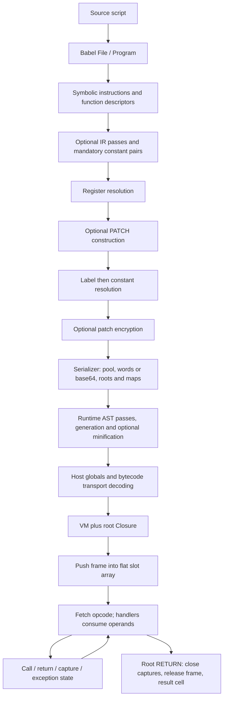

# js-confuser-vm - Virtualization Reference

Reference for the read-only `js-confuser-vm` encoder at tag `0.1.5`, commit
`20c5b96bf57337c568579352758d7685358650de`.

The encoder replaces supported JavaScript statements and expressions with a virtual program and
ships the interpreter needed to execute it. Source names become compiler-managed locals, captures
or host-global accesses; instructions become a flat word stream. The public asynchronous
`JsConfuserVM.obfuscate(source, options)` returns `{ code, profileData }`. `code` is a JavaScript
program that boots the virtual main function, rather than a stand-alone bytecode file.

## Prerequisites and scope

Readers need JavaScript functions, lexical scope, arrays, property access, exceptions and basic
VM concepts: a program counter selects an instruction, registers hold values, and a frame holds
one function invocation. The parser foundation here is Babel's `File` containing a `Program`
whose `body` is a statement list. Source parsing uses `sourceType: "script"` and
`allowReturnOutsideFunction: true`. The compiler wraps that list in a synthetic, parameterless
main function; a top-level return therefore returns from that virtual main function. Parsing a
syntax form does not promise that the lowering compiler implements it. For example, async and
generator functions are explicitly rejected.

Lowering uses its own `Scope`/`FnContext` model, rather than Babel scope bindings: it hoists local
names, assigns per-function virtual register IDs, recursively resolves enclosing locals into
upvalue descriptors, and treats unresolved names as host globals. Babel AST parsing/generation
also constructs the output runtime. Runtime rewrites use the supplied Babel dependency contract
below; source lowering continues to use the separate compiler-managed model.

This package describes one pinned system. The explicit **plain reference vector** sets every
representation-changing option in [options.md](options.md) to false. It still performs lowering,
constant-pair expansion, register/label/constant resolution, serialization and runtime building.
`DEFAULT_OPTIONS` is `{}`; omitted options do not turn those optional passes on. Plain output
provides a readable reference for the contracts, not a restriction on the variants the encoder
can emit. Optional paths remain in the workflow below even where their detailed specifications
and retained output evidence are missing.

### Runtime AST dependency contract

Runtime transform pages assume a supplied Babel parser, traversal/path/scope API, types builders
and generator compatible with the pinned runtime. These are infrastructure dependencies, not
transform algorithms to rebuild. Parsing assembled runtime uses `sourceType:"unambiguous"`;
small injected statements use script or unambiguous parsing and select the first Program statement.
A File owns Program.body; SwitchCase owns test/consequent, and function bodies are BlockStatements.
Leading/inner/trailing comments are attached metadata, with each pass specifying which it reads.

Deep clone creates independent descendant nodes while retaining identifier spellings; it does
not create new meanings for captured bindings. A NodePath supplies live parent/ancestry and
replacement; scope bindings identify declarations, referencePaths and constantViolations.
`scope.crawl()` refreshes that derived graph after raw case/body insertion. Traversal visits the
AST without executing it; fast identifier traversal counts nodes rather than resolved references.
Generation serializes the current tree; it does not implicitly prove semantic equivalence or
repair a public binding cache. The detailed passes specify their exact scope/capture decisions.

## Skill Layout

| Page | Contract owned here |
|---|---|
| [container-wordcode.md](container-wordcode.md) | Symbolic-to-word finalization, units, pools, root bindings, frame layout and runtime boot; annotated example and component acceptance plan. |
| [instruction-set.md](instruction-set.md) | Canonical operand grammar and runtime semantics; calls, captures, completion routing, exceptions and PATCH execution. |
| [options.md](options.md) | Option gates/effect inventory and remaining detailed mechanism dependencies. |
| [runtime layout](transforms/runtime-layout.md) | Coupled opcode/sentinel/frame allocation, decoy state and separate case shuffle. |
| [handler table](transforms/handler-table.md) | Case lifting, local/receiver/capture/exit contracts and prototype installation. |
| [class runtime](transforms/class-runtime.md) | Constants, class/record member renaming, paired parameter rewrites and boot ordering. |
| [final minification](transforms/minify-runtime.md) | Whole-source external optimizer invocation, publication and emitted-shape evidence limits. |
| [aliased opcodes](transforms/aliased-opcodes.md) | Fixed-arity candidate selection, operand permutations and matching eager-read clones. |
| [macro opcodes](transforms/macro-opcodes.md) | Repeated window selection, concatenated tails, sequential bodies and finite terminal restrictions. |
| [specialized opcodes](transforms/specialized-opcodes.md) | Whole-tuple selection, placeholder identity/resolution and baked operand handlers. |
| [anti-instrumentation](transforms/anti-instrumentation.md) | Real/fake step grammar, register seeds/anchors, permutation and matching fused handlers. |
| [self-modifying wordcode](transforms/self-modifying-wordcode.md) | Exact region/budget/decoy/routing construction, final-word encryption and shared destination/opaque-width interfaces. |
| [keyed constants](transforms/keyed-constants.md) | Mandatory pair expansion, first-value interning, exact UTF-16/integer storage and constant-reader consumption. |
| [shared string bank](transforms/shared-string-bank.md) | Padded bank construction, virtual inflate/decode helpers, slice calls and ancestor capture threading. |
| [state control flow](transforms/state-control-flow.md) | Block/state dispatch, direct-entry seeds, pinning, fake blocks and literal fallback boundaries. |
| [encoded branch dispatch](transforms/encoded-branch-dispatch.md) | u32 bijections, final-PC encoding, conditional endpoint selection and helper interfaces. |
| [symbolic helper assembly](symbolic-helper-assembly.md) | Shared child compiler/descriptor setup, inline remapping, function partition/tails and register occurrence contracts. |
| [source-map.md](source-map.md) | Reverse lookup of pinned implementation sources and explicit unclaimed files. |

The container foundation and canonical instruction semantics specify bounded container, grammar,
handler and completion units. The runtime representation pages supply their consequential
algorithms and declared Babel/optimizer dependencies. The option inventory links the detailed
protection recipes, while full AST lowering remains supplied compiler infrastructure. The recipes'
source-derived mechanisms and bounded examples do not supply all direct/generated evidence needed
for reconstruction of the whole compiler/interpreter or qualification of any optional stack.
The added-opcode pages close their source-derived producer/runtime recipes, using shared
allocation in runtime layout and width/identity in the container. Direct edge/state controls
and generated-output qualification remain bounded separately. The
[PATCH producer/encryption recipe](transforms/self-modifying-wordcode.md) supplies its source-derived
contract, with separate owner controls and a [bounded cold proof](transforms/self-modifying-wordcode.md#fixtures)
of selected mechanics. Actual resolver/runtime/composed/generated execution remains unverified. The keyed-constant,
string-bank and control-flow pages close their source-derived recipes through the linked shared
helper assembly contract. Their deterministic owner examples supply bounded arithmetic/IR oracles;
raw helper lowering, actual runtime state and retained generated/composed qualification remain
separate evidence debt. The [frozen selected value/control proof](symbolic-helper-assembly.md#frozen-selected-mechanics-proof-boundary)
reconstructs bounded symbolic/scalar subsets with supplied helper IR and fixed choices; component
pages state the scaffold deviations and exclusions separately from owner examples.

## Compiler order

The ordering separates symbolic work from concrete addresses. A pass that adds operand words must
run before label addresses are measured, and a pass encrypting words needs their final values.
The compiler applies the following sequence; optional steps run only under their own gates.

| Order | Stage | Result consumed next |
|---|---|---|
| 1 | Compiler construction and source lowering | Opcode/sentinel/frame choices; symbolic instructions and function descriptors. Main is descriptor zero; bodies are concatenated in descriptor order with entry labels. |
| 2 | Optional string concealment -> control-flow flattening -> dispatcher | Rewritten symbolic instruction lists. |
| 3 | Mandatory `concealConstants` | Each constant operand becomes adjacent value/key placeholders, even with concealment false. |
| 4 | Optional anti-instrumentation -> specialized -> macro -> aliased opcodes | Added/replaced instructions and their runtime-build metadata. Anti-instrumentation emits its own constant pairs after expansion. |
| 5 | `resolveRegisters` | Concrete function-relative slots and function register counts. |
| 6 | Optional self-modifying region construction | PATCH/moved-region structure using concrete register slots. |
| 7 | `resolveLabels` | Absolute word PCs and descriptor start PCs; pseudo-instructions remain available for comments. |
| 8 | `resolveConstants` | Pool indexes/keys and constant pool, with no further operand-width expansion. |
| 9 | Optional patch encryption | Final encrypted region words; all operand values are available. |
| 10 | Serializer | Numeric word array or base64 transport, pool, roots, maps, layout and runtime template. Null pseudo-instructions/placeholder operands are omitted from the flat stream. |
| 11 | Runtime AST building | Specialized -> macro -> aliased -> anti-instrumentation handlers, then case shuffle -> handler table -> class obfuscation, under their gates. Macro handlers require a nonempty macro map as well as the option. |
| 12 | Generation, comment prefix, optional final minification | Returned JavaScript `code` and profile data. |

Opcode-value randomization happens during compiler construction; case shuffling happens later in
runtime building. They change different things. `classObfuscation` and `minify` are read only
in runtime building and final generation (stages 11-12), after the serializer has fixed words,
pool, roots and maps. So for one seed and otherwise identical options, toggling either leaves
that payload unchanged; total RNG draw counts may still differ. The serializer constructs declarations and appends
the type-stripped runtime text following its `@START` marker. Source execution strips TypeScript
from the template; the distribution build embeds that stripped text. The runtime builder parses
this assembled text with
`sourceType: "unambiguous"`, transforms its AST, generates JavaScript, prepends instruction comments,
and then optionally minifies. Comments may aid inspection but do not give words their meaning.

## Execution flow

The first half produces both the program data and the interpreter with matching maps. The second
half executes that relationship: boot chooses host globals, materializes words when transport is
encoded, builds a root closure from the root PC/register count, and pushes its frame. Dispatch
reads the opcode and each handler reads its operands while advancing that frame's PC. Calls link
frames or invoke host callables; captures share upvalue cells; exception unwinding walks callers.
A normal root return stores the result in slot zero and makes `VM.run` return it. The generated
boot expression discards that return value; observable program effects come from the virtual
program's host calls and global/property mutations.

The [container specification](container-wordcode.md#2-algorithm) walks a small program through
those transitions. Its [frame contract](container-wordcode.md#frame-and-capture-state) defines the
register/slot distinction. Instruction-specific call, completion and exception semantics
are specified by the [instruction contract](instruction-set.md#3-implementation).

## Known boundaries

- A word is u32; some source comments still say u16. The opcode allocation range and spread
  sentinel range do not define transport width.
- The plain `CALL_SPREAD` operand is `65535`; randomized builds choose their sentinel separately.
- `DEBUGGER` is a source statement operation. PATCH is emitted by self-modifying hardening, and
  its encrypted regions are not ordinary canonical instructions.
- Source inspection establishes this order and the bounded container contracts. It does not
  establish all JavaScript syntax support, all option interactions, or whole-program
  reconstruction. Evidence limitations are indexed in the container's closing section.

## Source

All source links name the pinned commit. Public entry and parser/lowering wiring are
[index.ts#L7-L13](https://github.com/MichaelXF/js-confuser-vm/blob/20c5b96bf57337c568579352758d7685358650de/src/index.ts#L7-L13),
[compiler.ts#L162-L278](https://github.com/MichaelXF/js-confuser-vm/blob/20c5b96bf57337c568579352758d7685358650de/src/compiler.ts#L162-L278),
[compiler.ts#L517-L605](https://github.com/MichaelXF/js-confuser-vm/blob/20c5b96bf57337c568579352758d7685358650de/src/compiler.ts#L517-L605)
and [compiler.ts#L847-L873](https://github.com/MichaelXF/js-confuser-vm/blob/20c5b96bf57337c568579352758d7685358650de/src/compiler.ts#L847-L873).
Template preparation is [compiler.ts#L34-L40](https://github.com/MichaelXF/js-confuser-vm/blob/20c5b96bf57337c568579352758d7685358650de/src/compiler.ts#L34-L40)
and [babel-plugin-inline-runtime.cjs](https://github.com/MichaelXF/js-confuser-vm/blob/20c5b96bf57337c568579352758d7685358650de/babel-plugin-inline-runtime.cjs).
The Compiler order table is wired by
[compiler.ts#L377-L417](https://github.com/MichaelXF/js-confuser-vm/blob/20c5b96bf57337c568579352758d7685358650de/src/compiler.ts#L377-L417),
[compiler.ts#L3276-L3458](https://github.com/MichaelXF/js-confuser-vm/blob/20c5b96bf57337c568579352758d7685358650de/src/compiler.ts#L3276-L3458)
and [build-runtime.ts#L17-L124](https://github.com/MichaelXF/js-confuser-vm/blob/20c5b96bf57337c568579352758d7685358650de/src/build-runtime.ts#L17-L124).
The Execution flow's boot/return path is
[runtime.ts#L645-L675](https://github.com/MichaelXF/js-confuser-vm/blob/20c5b96bf57337c568579352758d7685358650de/src/runtime.ts#L645-L675)
and [runtime.ts#L947-L976](https://github.com/MichaelXF/js-confuser-vm/blob/20c5b96bf57337c568579352758d7685358650de/src/runtime.ts#L947-L976).
The empty default is [options.ts#L100](https://github.com/MichaelXF/js-confuser-vm/blob/20c5b96bf57337c568579352758d7685358650de/src/options.ts#L100).

## Fixtures

The [container evidence index](container-wordcode.md#fixtures) maps encoder-local test sources to
bounded claims and names missing direct controls. There are no retained generated containers in
this package. These pages do not report a fresh encoder-output qualification, whole-instruction
reconstruction or novice reader study. Docs here also cite *retired* verifiers: one-off
document-first reconstructions built from these docs before source consultation. A claim citing
one is a historical result with no maintained check.
