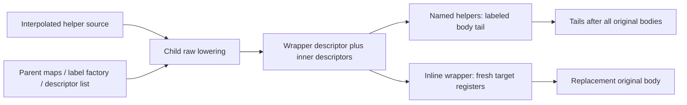

# Symbolic helper assembly

## 1. Target

The string-bank and control-flow passes add virtual functions and inline dispatch code to an
already lowered program. This specification owns their shared assembly operations: helper source
becomes symbolic IR using the parent's opcode meanings, new register identities avoid existing
identities, and helper bodies remain separately addressable after insertion. It describes the
pinned source, not an independently reconstructed compiler.

Readers need functions, lexical captures, arrays and mutable object identity. Start with the
[package prerequisites](js-confuser-vm.md#prerequisites-and-scope) and
[symbolic operand/finalization contracts](container-wordcode.md#symbolic-operands-and-register-assignment).
The raw compiler is a **supplied dependency**: `Compiler.compile` parses script source with
`allowReturnOutsideFunction:true` and returns raw lowering IR without running protection or
resolution passes. Its complete JavaScript lowering algorithm is outside this page. A bounded
proof may supply raw helper IR instead, but must identify that substitution explicitly.

## 2. Algorithm

Compile a helper in a fresh child compiler, sharing the parent's descriptor list and label factory
but copying its operation maps and sentinel values. The child therefore creates distinct labels
and descriptor indexes in the same virtual program without applying the parent's optional passes
recursively. A helper's wrapper main function is retained in the descriptor list but excluded from
the returned helper body. Named/nested functions follow it and are returned with entry labels.

For inline code, take the wrapper main body's IR instead. Remap all its register occurrences to
fresh identities in the target function, retaining each occurrence's other properties. Recover
named local registers from the wrapper's scope, remove its entry and ordinary implicit-return
suffix, and let the caller splice the remaining control flow into that function. Named inner
function bodies still form a separate tail. Source annotations belonging to template text are
removed from returned instructions because their positions do not describe the original program.

Function partitioning snapshots the known entry labels, walks each original body once, and emits
each callback's replacement immediately after the original entry. Helper tails wait until every
original body has been processed. A newly appended helper is therefore not recursively rewritten
by that invocation of the partitioner; a later pass can see its entry and body.

The parent descriptor list is shared mutable state, while opcode maps are copied values. Those
different relationships explain why helpers have fresh parent-visible function indexes but do
not establish new opcode allocations in the parent.

### Synthetic remapping example

Supply a target function 2 whose observed maximum ID is 7. A hypothetical raw inline wrapper
function 9 uses separate operand objects for register IDs 3 and 5 and exposes local `state` as
ID 3. Scan its instructions in order: first occurrence of 5 maps to `(2,8)`, first occurrence of
3 maps to `(2,9)`, and later occurrences of 5 reuse identity `(2,8)` while remaining separate
objects. The returned local map contains `state -> (2,9)`; `maxId[2]` becomes 9. Occurrence
metadata such as `kind:"temp"` stays attached during this in-place remap.

For a separate assembly control, input `preamble, entry(A), A-body, entry(B), B-body` with callback
outputs `(A-new, A-helper)` and `(B-new, B-helper)` becomes
`preamble, entry(A), A-new, entry(B), B-new, A-helper, B-helper`. Internal labels in A-body do
not end A. These examples supply raw IR and descriptor metadata; they do not execute lowering.

## 3. Implementation

### Component contracts

| Component | Consumes -> produces | Consequential invariant |
|---|---|---|
| Interpolation | Text plus substitution record -> text | Only brace-word placeholders are substituted; no AST substitution or escaping. |
| Child setup | Parent maps/list plus text -> appended descriptors | Parent label factory is used directly; child optional passes remain disabled. |
| Named-body collector | Descriptor suffix -> inner descriptors/labeled bodies | Skip only the wrapper descriptor; retain all later descriptors in order. |
| Inline remapper | Wrapper IR/locals, target ID, max-ID map -> inline IR/local map | Fresh IDs by first encounter; same old ID maps consistently. |
| Function partitioner | Original flat IR/entry inventory -> replacements then tails | Entries/preamble survive; callbacks receive bodies without entry markers. |
| Register helpers | Identity or observed maxima -> fresh operands/IDs | Fresh occurrence objects prevent shared placeholder mutation. |

### Exact Template procedure

1. Replace matches of `/\{(\w+)\}/g`. Require `name in variables`; otherwise throw
   `Template: missing variable {<name>}`. Substitute `String(variables[name])`. This uses inherited
   properties too and performs no quoting. Braces in object literals need not match this pattern.
2. Construct `new Compiler({...DEFAULT_OPTIONS,randomizeOpcodes:false})`. Assign shallow copies of
   parent `OP`, `OP_NAME`, `SENTINELS` and a fresh Set of parent `JUMP_OPS`. Bind the child's
   `_makeLabel` directly to the parent's method. Record `startIdx=parent.fnDescriptors.length`,
   point child `fnDescriptors` to that same array, then call raw `compile(text)`.
3. Named `compile` returns `functions=parent.fnDescriptors.slice(startIdx+1)`. For each such
   descriptor, emit `[null,defineLabel(desc.entryLabel)]` followed by `desc.bytecode`. Delete
   `SOURCE_NODE_SYM` on each returned instruction. The wrapper descriptor and its body remain
   parent-visible but are not emitted by this method; there is no descriptor removal or rollback.
4. `compileInline` instead obtains `parent.fnDescriptors[startIdx]`, its `_fnIdx` and body. Scan
   operand positions 1 onward; for each register belonging to that wrapper function, use one
   old-ID map and increment target max-ID on first encounter. Assign its `id` and `fnId` in place.
   Other fields and registers belonging to other functions are unchanged.
5. Iterate the wrapper scope's `_locals`. Return a local-name entry only if its old register ID
   appeared in the remap. Filter out its entry defineLabel. If the last two instructions are
   `LOAD_CONST` then `RETURN`, remove both, without checking their operands or value. This literal
   suffix test assumes the supplied raw compiler's implicit return pattern; it is not an arbitrary
   IR return recognizer. Strip source symbols, collect inner bodies as above, and return
   `{bytecode,registers,functions,innerBytecode}`.

The supplied raw compiler's emit operation JSON-clones register operands before storing each
instruction, retaining their serializable identity/metadata while keeping scope-local register
objects separate. Inline occurrence mutation therefore does not change the scope locals' old IDs
used by step 5. Non-register operand objects are retained. A raw-IR substitute must preserve this
scope-versus-occurrence separation; an aliasing substitute can silently lose the local-name map.

Inline remapping does not rewrite inner-function capture metadata referencing wrapper locals.
These passes use no such inline captures. Cross-call-site capture substitution is not supplied
by Template. Helper register counts remain symbolic `fnRegCount(fnId)` until parent resolution.
Only returned source symbols are stripped; discarded wrapper instructions need not lose theirs.

CFF's supplied raw-lowering interface additionally recognizes `_VM_JUMP_("label")` as a direct
`JUMP label`, with a discarded dummy register result. Its labels can refer to parent IR absent
from the child's body. Inline while lowering provides defineLabels whose names contain
`while_top` and `while_exit`; the CFF page owns selection and its missing-label errors. These
are compiler dependency contracts, not generic JavaScript APIs.

### Exact shared register and partition operations

`ref(r)` returns a new `{type:"register",id:r.id,fnId:r.fnId}`. It does **not** copy `pinned`,
`kind`, `scopeId`, `resolvedValue` or custom markers. Logical identity is preserved, occurrence
metadata is not. A consumer needing an existing pin must retain that marked occurrence or assign
the pin to the fresh one, preserving the required metadata on the first emitted occurrence of
that identity. The [allocator](container-wordcode.md#symbolic-operands-and-register-assignment)
records its pool only from that first occurrence; later pins do not replace it. This is why the
branch dispatcher preserves original condition objects. Fresh-ref independence alone does not
prove correct physical allocation.

`buildMaxIdMap` scans every instruction's operand positions, including pseudo and hidden
operands, and records maximum `id` for operands of type register per `fnId`; missing maxima
start at -1. It does not consult descriptor register counts or reserved-register metadata.
`allocReg(fnId,maxId)` writes `(maxId.get(fnId) ?? -1)+1` and returns a fresh plain register
operand. Unused allocated IDs consume no physical slot. `extractLabel` returns `.label` only
for an object with type label, otherwise null; it does not validate ownership or existence.

`forEachFunction` snapshots descriptor entry labels and their fnId map before callbacks. For
each null-op defineLabel in that set, collect following instructions through the next such
entry or end, call `transform(body,fnId)`, emit the original entry then `instrs`, and enqueue a
nonempty optional `tail`. Other instructions outside a collected body pass through. After the
scan, concatenate queued tails in callback order. No re-scan or CFG validation is performed.

These operations mutate private compilation state: descriptors, operand occurrences and max-ID
maps. There is no atomic per-helper rollback. Public whole-source publication is owned by the
[container](container-wordcode.md#emitted-forms-failures-and-publication); helper failure does not
publish partial code. Register/label/pool resolvers subsequently close the emitted state contract.

### Testing and acceptance design

| Scenario | Observable result / oracle | Acceptance criterion | Evidence/control |
|---|---|---|---|
| H1 interpolation | Supplied `{name}` and missing key reach substitution/error | Exact pattern, inherited-key behavior and String conversion; no pretend escaping | [Frozen selected H1 control](#fixtures); actual invocation missing |
| H2 parent/child linkage | Descriptor suffix/maps/labels inspectable after raw lowering | Shared list, copied maps, parent label allocation, discarded wrapper retained | [Frozen selected H2 maps/list](#fixtures); real child/bound label receiver/lowering missing |
| H3 inline remap | Supplied IR produces example identity/local/max map | First-encounter IDs, preserved occurrence metadata, literal suffix removal | [Frozen selected H3](#fixtures) plus owner example; raw lowering omitted |
| H4 partition/tails | Exact concatenation of supplied bodies | Internal labels do not partition; new helper tails are not revisited | [Frozen selected H4](#fixtures) plus owner assembly example |
| H5 occurrence flags | Two fresh refs share identity only; marked original retains pin | Mutating one placeholder flag cannot affect the other; explicit pin ownership | [Frozen selected H5 refs](#fixtures); first-pool/physical allocation missing |

## 4. Later Stages

| Later pass | Effect on helper output |
|---|---|
| String -> CFF -> dispatcher | A later partitioner sees earlier helpers already appended; each pass's current snapshot governs that invocation. |
| Mandatory constant pairs | All helper constants acquire adjacent index/key operands before width measurement. |
| Augmentation | Occurrence independence and encoded-label identity matter when placeholders/permutations are installed. |
| Registers -> labels -> constants | Fresh identities receive slots/counts; emitted bodies receive PCs; discarded wrapper entry can remain absent from label map. |
| Serialization/runtime building | Pseudo entries disappear; helpers execute through canonical closures/calls rather than new runtime AST handlers. |

## 5. Known Quirks

No complete raw helper-lowering recipe is promised. Named Template compilation retains otherwise
discarded wrapper descriptors. Inline compilation assumes its raw implicit-return suffix and does
not remap inner captures. Fresh refs intentionally lose occurrence flags. Partitioning relies on
descriptor entry labels; it supplies no malformed-IR guard. A specification-only scaffold can
verify these local decisions but cannot qualify the actual compiler, runtime or option stack.

## Source

All links name `20c5b96bf57337c568579352758d7685358650de`.
Template interpolation/setup/collection and inline remapping are
[template.ts#L60-L279](https://github.com/MichaelXF/js-confuser-vm/blob/20c5b96bf57337c568579352758d7685358650de/src/template.ts#L60-L279).
Shared helpers and the snapshot/tail procedure are
[pass-utils.ts#L10-L126](https://github.com/MichaelXF/js-confuser-vm/blob/20c5b96bf57337c568579352758d7685358650de/src/utils/pass-utils.ts#L10-L126);
register object construction is
[types.ts#L94-L104](https://github.com/MichaelXF/js-confuser-vm/blob/20c5b96bf57337c568579352758d7685358650de/src/types.ts#L94-L104).
The supplied raw compiler boundary is
[compiler.ts#L517-L535](https://github.com/MichaelXF/js-confuser-vm/blob/20c5b96bf57337c568579352758d7685358650de/src/compiler.ts#L517-L535),
descriptor creation is
[compiler.ts#L560-L566](https://github.com/MichaelXF/js-confuser-vm/blob/20c5b96bf57337c568579352758d7685358650de/src/compiler.ts#L560-L566),
scope/occurrence separation is
[compiler.ts#L359-L373](https://github.com/MichaelXF/js-confuser-vm/blob/20c5b96bf57337c568579352758d7685358650de/src/compiler.ts#L359-L373),
and parent-label intrinsic lowering is
[compiler.ts#L1826-L1843](https://github.com/MichaelXF/js-confuser-vm/blob/20c5b96bf57337c568579352758d7685358650de/src/compiler.ts#L1826-L1843).
The forcing positions in item 4 are wired by
[compiler.ts#L3285-L3346](https://github.com/MichaelXF/js-confuser-vm/blob/20c5b96bf57337c568579352758d7685358650de/src/compiler.ts#L3285-L3346).

## Fixtures

### Frozen selected-mechanics proof boundary

The retired frozen verifier retained the exact
synthetic inputs and oracles, and listed its input documents when run. One
context-free architect reconstructed selected mechanics from the eleven declared candidate pages
and governing instructions before consulting implementation source. Six selected cold groups
passed with fixed choices, supplied raw helper IR/descriptors and generic scalar/value oracles.
Source consultation occurred only after the tool/results were frozen. This is a competent-agent
bounded reconstruction, not a novice reader study.

The proof changes IR/pairs/pool/captures/state routes and tests named negative decisions with
opposite valid controls; passthrough fails its selected checks. Named refusal controls concern
reconstructed components, not observed encoder/publication failures. Linked recipe text can
change after the freeze: rerunning the tool reads the live documents, so a later semantic pass
is not exact reproduction of the frozen run.

| Frozen group | Selected credit | Excluded evidence |
|---|---|---|
| H1-H5 selected assembly | Interpolation refusal, selected copied maps/shared descriptors, scope/occurrence remap, suffix, refs and partition/tails | Real child constructor, bound label receiver, raw lowering, complete descriptor/capture state or allocator |
| K1-K5 selected constants | Pair change, Map/key reuse, UTF-16/int32 edges, hidden object channels and baked/missing reader PC | Actual resolver/runtime/host; rebuilt instruction arrays/source symbols or full finalizer state |
| S1-S5 selected bank | Slice/table arithmetic, eligibility, ancestor counts/pairs and logical call destination | Exact per-user scratch allocation/fresh destination flags, real Template wrapper/helper/capture frames |
| C1-C4 selected CFF | Three-record chunks, cross-block pins, conditional outgoing deltas, direct seed/no-seed and raw-loop metadata refusals | Actual dispatch loop/fakes/end/handler/finally execution, physical allocation or complete CFF producer |
| D1-D5 selected dispatcher | Primitive inverses, endpoint/branchless route IR, hidden identity/late transforms and named errors | Source sampler population, complete finalizer state, real helper/frame or exact source layout |
| D2-D4 emitted routes/interfaces | Changed conditional routes and parameter/result scalar alias oracles | Source-faithful array/object selector words/pairs, closure prologue, raw helper lowering/real VM |

The bank scaffold allocates key/start/length per site, whereas source allocates and reuses them
per direct-user function. It retains the original destination object, whereas source `ref(dst)`
creates a fresh occurrence with the same logical identity and omits flags. Its two supplied helper
descriptors omit Template's retained wrapper. Helper setup uses direct parent-label reference
rather than source's bound method. These differences prohibit exact producer/allocation/descriptor
closure credit, although the source-derived recipe remains independently specified above.

The dispatcher array scaffold loads selector zero through LOAD_CONST, whereas source uses
LOAD_INT; its object selector is supplied as a scalar rather than the later-expanded constant
pair. Its nine-step all-kind inversion stress includes both key kinds, outside source's four-to-
seven-step sampler with exactly one key kind. That stress establishes primitive arithmetic
inversion only; the fixed four-step example is a source-valid supplied scheme shape. Selected
label/intern rebuilds preserve operand channels but omit returned-instruction/source-symbol and
descriptor startPc state. CFF's loop/fakes/end-state and helper/handler/frame/physical-slot execution
are excluded. No full producer, exact final layout, real runtime/host, generated/composed program
or public failure admission follows from the proof. The first-occurrence allocator decision is
source-derived and was not rebuilt or executed by this tool.

### Helper evidence index

| Evidence | Scenario and bounded assertion | Remaining boundary |
|---|---|---|
| Retired frozen verifier | H1-H5 selected interpolation/refusal, maps/descriptors, remap/scope separation, suffix/ref/partition decisions | Supplied descriptors/raw IR; no actual child constructor/bound label receiver or complete helper lowering/capture/allocator |
| Item 2 examples and generic owner calculation | H3 first-encounter IDs/maxima; H4 supplied concatenation oracle | Source-informed owner examples; separate from the cold result |
| No actual helper-assembly fixture | Real lowering, helper descriptor integration, captures and physical allocation | Remain unverified |

H1's missing-variable and H3/H4/H5's occurrence/partition checks are selected reconstructed
controls. H2 copied-map/shared-list checks do not prove actual Template invocation or label binding.
The source-informed examples above retain their supplied inputs/oracles and provenance; they were
not relabeled as independent source/runtime observations.
