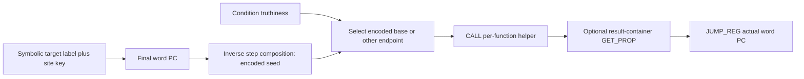

# Encoded branch dispatch

## 1. Target

The dispatcher replaces eligible ordinary branch destinations with encoded PC seeds, per-site
keys and calls to a per-function virtual decode closure. Its shared route ends in JUMP_REG to
the materialized absolute word PC. Conditional routes select one of two encoded endpoints
without retaining the original conditional branch. This page specifies the pinned algorithm,
including unsigned arithmetic, delayed label encoding and helper parameter/result choices.
It makes no generated-output, arbitrary-IR or complete option-stack admission claim.

Readers need registers, labels, calls, JavaScript truthiness and u32 bitwise arithmetic. Read the
[package prerequisites](../js-confuser-vm.md#prerequisites-and-scope),
[helper assembly](../symbolic-helper-assembly.md),
[word-width/identity interface](../container-wordcode.md#augmentation-operand-handoff), and
[canonical instruction semantics](../instruction-set.md#3-implementation). Raw helper lowering,
host Math.imul and canonical calls/property reads are declared infrastructure. The helper's
execution is a virtual function; there is no dispatcher runtime AST pass.

## 2. Algorithm

For every function containing JUMP/JUMP_IF_FALSE/JUMP_IF_TRUE, choose one random bijection of
u32 values and a parameter/result interface. Compile its decode helper as ordinary virtual
instructions and create that closure once in the transformed function's prologue. Allocate
registers for encoded PC, site key, optional high key half/result selector and conditional scratch.

An unconditional branch to a symbolic label loads that label's encoded value and a fresh site
key, then jumps to a shared dispatcher block. Its encoded value is not computed until label
resolution knows the target's final word PC. A label operand's transform applies the inverse
composition of the decode steps; an assertion checks decode(encode(pc)) against the u32 PC.
The helper applies the forward composition to recover the actual destination.

For a conditional branch, emit `t=+!condition`, exactly 0 or 1. Load encoded values of both the
t=0 and t=1 endpoints, select with either multiplication by t or bitwise AND with -t, and
enter the same dispatcher. JUMP_IF_FALSE assigns the taken target to t=1; JUMP_IF_TRUE assigns
it to t=0. The untaken endpoint is a newly inserted skip label after that route. The original
condition object is retained so any earlier CFF pin remains visible to register allocation.

The dispatcher calls the closure with the scheme's argument order, obtains a direct PC or a
one-element array/object containing it, optionally extracts that result, and performs JUMP_REG.
Append helper bodies after all original function bodies. This step follows CFF so CFF's emitted
branches can use the same branchless selection; it precedes register/label resolution so added
instructions contribute to the final physical slots and word addresses.



Each site can have a different key while using the same function-level steps. Final-PC encoding
must wait for width-changing passes; the instruction occurrences and transform metadata must
remain linked through that wait.

### Synthetic arithmetic and route example

Choose decode steps, in order, `mul(3)`, `xorshift(16)`, `keyXor`, `add(7)`, key 0x80000005,
parameter mode split and return mode array. This step list has the required multiply, xorshift,
one key step and one allowed extra. The inverse of 3 modulo 2**32 is 2863311531.
For supplied final PCs base=100/other=200, inverse steps run as subtract 7, XOR key, xorshift16,
then imul by 2863311531. Encoded seeds are 2147494600 and 2147494636; forward decode gives
100 and 200 respectively. These are supplied addresses, not an exact final compiler layout.

For JUMP_IF_FALSE target=200, skip=100, truthy condition gives t=0 and selects base;
falsy condition gives t=1 and selects other. Delta is 36. Multiplication selects `base+t*36`;
AND mode first converts t to 0/-1 and selects `base+((-t)&36)`. Site key halves are 5/32768.
The shared dispatcher calls decode(encoded,5,32768), whose prelude recombines
`(5|(32768<<16))>>>0 = 2147483653`; decode returns `[PC]`. It loads selector 0, executes
GET_PROP rDisp,rDisp,rOut to obtain the PC, then JUMP_REG rDisp. CALL reads its arguments
before writing rDisp, and GET_PROP reads the old rDisp object before assigning the extracted PC.

A separate width/coercion control uses supplied mathematical PCs 0/2 with the same scheme/key.
Seeds are 715816961/3579128491; delta=2863311530. AND mode converts delta to -1431655766,
so the selected runtime Number can be -715838805, rather than the displayed unsigned seed.
Helper `applyDecode`/its first bitwise step operates on that Number's u32 pattern, yielding PC 2.
Thus selection need only agree modulo 2**32 in this mode. These negative runtime values are
register contents, not invalid negative LOAD_INT words. Arithmetic control covers exact endpoint
selection and high-bit key behavior; it omits raw helper lowering, frame state and final widths.

## 3. Implementation

### Components and exact decode scheme

| Component | Consumes -> produces | Consumer invariant |
|---|---|---|
| Scheme selector | Random choices -> steps/parameter/result source | Every forward step is a u32 bijection with specified inverse. |
| Encoded-label builder | Label/key/scheme -> label operand with transform and ID | Encode only after final PCs; unique marker survives JSON tuple identity. |
| Per-function assembly | Candidate body/scheme -> prologue/replaced branches/dispatcher | Scratch locals never reuse slots; condition marker object survives. |
| Helper/result execution | Args/virtual body -> PC or container -> JUMP_REG | Match argument and result mode; CALL/GET_PROP aliasing follows canonical reads. |
| Late finalizer | Filtered widths/labels -> encoded numeric operands | Offset before transform; Object.assign preserves attached identity fields. |

Every table result uses `>>>0` after the operation. Addition/subtraction are Number operations;
product is Math.imul, not ordinary floating multiplication. Bitwise operations use JavaScript
int32 conversion; shift counts are as constrained below.

| Step | Forward decode F(x,k) | Inverse used in encoding |
|---|---|---|
| xor(c) | `(x ^ c)>>>0` | Same |
| add(c) | `(x+c)>>>0` | `(x-c)>>>0` |
| sub(c) | `(x-c)>>>0` | `(x+c)>>>0` |
| mul(c,cInv) | `Math.imul(x,c)>>>0` | `Math.imul(x,cInv)>>>0` |
| xorshift(s) | `(x^(x>>>s))>>>0` | Same, s=16..31 |
| rot(n) | `((x<<n)\|(x>>>(32-n)))>>>0` | `((x<<(32-n))\|(x>>>n))>>>0` |
| not | `(~x)>>>0` | Same |
| keyXor | `(x^k)>>>0` | Same |
| keyAdd | `(x+k)>>>0` | `(x-k)>>>0` |

Choose multiply c as `(getRandomInt(1,0xffffffff>>>1)*2+1)>>>0`: an odd integer in
3..0xffffffff, excluding 1. Compute cInv by extended Euclid with BigInt modulus 1n<<32n:
start `(oldR,r)=(BigInt(c>>>0),MOD)`, `(oldT,t)=(1n,0n)`; while r!=0, q=oldR/r, update
`(oldR,r)=(r,oldR-q*r)` and `(oldT,t)=(t,oldT-q*t)` using old values; normalize
`Number(((oldT%MOD)+MOD)%MOD)`. Oddness guarantees an inverse.

Initialize steps with mul, xorshift(random16..31), and chance(50) keyXor else keyAdd.
Choose 1..4 extras independently with replacement: equally indexed xor/add/sub/rot/not;
xor/add/sub c is 1..0xffffffff, rot n is 1..31. Shuffle the entire list using the
[primitive sampling contract](runtime-layout.md#components-and-exact-allocation). Thus list length
is 4..7, exactly one key step, and a mandatory xorshift/multiply; extras may duplicate kinds.
Encoding starts `v=pc>>>0` and applies inverse steps in reverse list order. Decode starts
`v=x>>>0` and applies forward steps in list order. A generated helper renders the same forward
operations on local x; its mandatory operations coerce the initial Number to a u32 pattern.

Choose paramMode independently from xk/kx/split and returnMode from direct/array/object using
uniform array choice. Always generate propName, even when unused: lowercase letter, digit 0..9,
then 2..4 independently chosen lowercase letters. This shape cannot be a reserved word. Helper
parameters are `(x,k)`, `(k,x)` or `(x,kLo,kHi)`; split prelude is
`var k=(kLo|(kHi<<16))>>>0`. Apply rendered forward steps, then `return x`, `return [x]`, or
`return { <propName>:x }`. This is explanatory helper logic; its raw compilation belongs to the
supplied lowering dependency.

### Label identity and final-PC update

For every encoded endpoint create a fresh `{type:"label",label,_id,transform}` object. `_id`
increments a module-level counter from zero, across pass invocations; it is not reset per compiler.
The transform captures siteKey/scheme, computes inverse composition of pc, and asserts
`applyDecode(steps,encoded,siteKey) === (pc>>>0)`, with message
`dispatcher: decode(encode(pc)) !== pc - decode scheme inverse is wrong`
(the source message uses an em dash). It returns the encoded u32.

The ID is consequential because JSON tuple identity does not serialize functions: distinct
encoded label sites must not become indistinguishable when their transforms are absent from the
stringified comparison. Specialized operands retain the original object as the late-resolution
channel. Label resolution first measures [filtered emitted widths](../container-wordcode.md#word-addresses-and-serialization),
looks up labelPc, adds `offset??0`, invokes transform when present, and Object.assigns type number/
resolvedValue into that same object. `_id`, transform, label and placeholder markers survive.
No new key/label pair expansion occurs at this point. Undefined label throws at that finalizer;
the dispatcher does not prevalidate target existence or ownership.

### Exact per-function branch and route assembly

Use max-ID scan and the snapshot partitioner from
[shared assembly](../symbolic-helper-assembly.md#exact-shared-register-and-partition-operations).
Gate by any ordinary branch, even one with a non-label operand. If absent, no helper allocation.
Otherwise choose scheme, compile its decode helper and allocate in order rDisp, rKey, rKeyHi,
rClosure, rOut, rT, rDelta as fresh plain local registers. Some are absent from emitted operands
under simpler modes and consequently receive no physical slot. Generate a shared dispatcher label
from parent `_makeLabel("dispatcher")`. Hoist MAKE_CLOSURE rClosure,helperEntry,paramCount,
fnRegCount(helperId),0,0 before original body.

For JUMP with a label operand: draw siteKey in 1..0xffffffff; LOAD_INT rDisp,encodedLabel(target);
load key, then JUMP sharedDispatcher. Unsplit mode loads full siteKey into rKey; split loads
`siteKey&0xffff` into rKey and `siteKey>>>16` into rKeyHi. Non-label JUMP passes through.

For JUMP_IF_FALSE/TRUE with label target: draw one key and allocate skip label with target+"_skip"
hint. The pin has `BRANCHLESS_JUMPS=true`. Assign `(base,other)=(skip,target)` for false branch
or `(target,skip)` for true branch. Draw chance(50) useBand, then emit:

```text
explanatory symbolic lowering:
UNARY_NOT rT, originalConditionObject
UNARY_POS rT,rT
if useBand: UNARY_NEG rT,rT
LOAD_INT rDisp, encodedLabel(base,siteKey)
LOAD_INT rDelta, encodedLabel(other,siteKey)
SUB rDelta,rDelta,rDisp
(BAND if useBand else MUL) rDelta, rT,rDelta   # chance(50) swaps these inputs
ADD rDisp,rDisp,rDelta
load site key or halves
JUMP sharedDispatcher
defineLabel skip
```

All other register references in this construction are fresh identity-only refs. The original
condition occurrence carries CFF pinned metadata into this use. The allocator takes the pool from
that identity's first emitted occurrence, so producers must preserve the needed first pin rather
than rely on this or any later occurrence upgrading the pool. Delta is a difference of
u32 endpoints, exactly representable as Number; multiplying by 0/1 remains exact. AND wraps delta
to int32; the addition may differ by a multiple of 2**32, but forward decode operates on the same
u32 pattern. Truthiness handles objects, zero, empty strings, NaN and undefined through !cond;
no multiplication of the original potentially nonnumeric condition occurs.

An inactive source branch for BRANCHLESS_JUMPS=false instead emits an inverted conditional to skip
and routes only the taken edge. It is not a typed/public option or emitted alternative at this pin.
Non-label conditional operands pass through unchanged. After the rewritten original body, emit
the shared dispatcher block: defineLabel, CALL rDisp,rClosure with `(rDisp,rKey)`, `(rKey,rDisp)`
or `(rDisp,rKey,rKeyHi)`; direct mode needs no extraction. Array mode loads rOut=0 and GET_PROP
rDisp,rDisp,rOut. Object mode LOAD_CONST rOut,constant(propName), then the same GET_PROP.
Finally JUMP_REG rDisp. Helper IR is returned as tail. Ordinary lowered bodies end in return/
throw, so this appended dispatcher is entered by explicit routes; no guard blocks arbitrary
hand-built body's fallthrough into it.

### State, failure and acceptance

The pass mutates private descriptor/label/max-ID state and returns rewritten IR. Original
noncandidate instructions and condition operands survive; new instruction arrays generally do
not inherit original source annotations. No per-function rollback, address-domain/CFG validator
or partial publication is implemented. The encode assertion is a private build check against
its arithmetic mirror, not an observation of real generated helper execution. Runtime route
CALL may push/pop a normal helper frame, GET_PROP may throw under altered host behavior, and
JUMP_REG simply sets current frame PC from the register. Canonical capture/completion state and
whole-source publication remain shared dependencies.

| Scenario | Observable result / oracle | Acceptance criterion | Evidence/control |
|---|---|---|---|
| D1 step bijections | Fixed step/key/u32 boundary round trips | Reverse inverse order; exact imul/inverse/rotation/xorshift coercion | [Frozen selected D1 inverses](#fixtures); nine-step stress is outside sampler; generated population missing |
| D2 conditional truthiness | Base/other selection for both conditional opcodes | 0/1 or 0/-1 selection; high-bit AND modulo equivalence | [Frozen selected D2 changed routes](#fixtures) plus owner endpoints; actual handlers missing |
| D3 interface modes | Split halves/recombine; direct/array/object extraction | CALL consumes original args before dst write; GET_PROP aliases safely | [Frozen selected D3 scalar aliases](#fixtures); selector scaffold differs; real frames/runtime missing |
| D4 late PC/identity | Final filtered width -> per-site encoded object fields | Offset then transform; _id distinguishes sites; hidden refs mutate in place | [Frozen selected D4 hidden/late transforms](#fixtures); full resolver/descriptor/specialized graph missing |
| D5 gate/failure | Inert body or preserved nonlabel; named undefined-label/assertion | Control reaches named decision, no invented ownership validation | [Frozen selected D5 named controls](#fixtures); actual encoder/publication failures missing |
| D6 CFF/helpers/composed | Actual state/pins/PC routes/closures after later stages | Credited features execute and match program plus state oracles | Source schedule; generated/composed evidence missing |

## 4. Later Stages

| Later stage | Consequence |
|---|---|
| Constant expansion/value concealment | Helper constants/object selector gain pairs, influencing word width and stored values. |
| Specialized/macro/alias/anti | May bake/fuse/permute route operations; label _id and retained operand identity close final transforms. |
| Register resolution | Plain scratch locals start in local::; preserved original conditions retain their occurrence pins. First emitted metadata determines each identity's pool. |
| PATCH then label resolution | Region relocation and settled emitted widths precede final-PC encoding; transform runs only at resolution. |
| Runtime representations | Canonical CALL/scalars/GET_PROP/JUMP_REG implement helper routes despite changed dispatch layout/names. |

## 5. Known Quirks

Arithmetic self-check uses a compile-time mirror rather than the actual generated helper.
The module ID counter persists across compilations. Candidate gate can allocate a helper even
when no branch target is a label. Inactive legacy selection is not a public option. Appended
dispatcher fallthrough and label ownership are assumed from normal lowering, not guarded.
No real runtime/helper-frame/host or generated-stack qualification follows from arithmetic proofs.

## Source

All links name `20c5b96bf57337c568579352758d7685358650de`.
Steps and inverse/sampling are [dispatcher.ts#L194-L361](https://github.com/MichaelXF/js-confuser-vm/blob/20c5b96bf57337c568579352758d7685358650de/src/transforms/bytecode/dispatcher.ts#L194-L361);
interfaces/labels/block are [dispatcher.ts#L368-L509](https://github.com/MichaelXF/js-confuser-vm/blob/20c5b96bf57337c568579352758d7685358650de/src/transforms/bytecode/dispatcher.ts#L368-L509);
per-function routes are [dispatcher.ts#L515-L735](https://github.com/MichaelXF/js-confuser-vm/blob/20c5b96bf57337c568579352758d7685358650de/src/transforms/bytecode/dispatcher.ts#L515-L735).
Shared assembly is [template.ts#L84-L175](https://github.com/MichaelXF/js-confuser-vm/blob/20c5b96bf57337c568579352758d7685358650de/src/template.ts#L84-L175) and
[pass-utils.ts#L10-L126](https://github.com/MichaelXF/js-confuser-vm/blob/20c5b96bf57337c568579352758d7685358650de/src/utils/pass-utils.ts#L10-L126).
Late label mutation is [resolveLabels.ts#L29-L111](https://github.com/MichaelXF/js-confuser-vm/blob/20c5b96bf57337c568579352758d7685358650de/src/transforms/bytecode/resolveLabels.ts#L29-L111).
The CFF-before-dispatcher/width ordering in items 2/4 is
[compiler.ts#L3290-L3346](https://github.com/MichaelXF/js-confuser-vm/blob/20c5b96bf57337c568579352758d7685358650de/src/compiler.ts#L3290-L3346).
Indirect execution is [runtime.ts#L894-L898](https://github.com/MichaelXF/js-confuser-vm/blob/20c5b96bf57337c568579352758d7685358650de/src/runtime.ts#L894-L898);
complete CALL/GET_PROP semantics remain owned by the linked instruction specification.

## Fixtures

No retained generated dispatcher or direct actual helper/finalizer/runtime-state fixture is
supplied here. The
[shared frozen-proof boundary](../symbolic-helper-assembly.md#frozen-selected-mechanics-proof-boundary)
owns protocol/manifest and common exclusions.

| Evidence | Scenario and selected assertion | Exclusion |
|---|---|---|
| Retired frozen verifier | D1-D5 selected primitive inverses, changed endpoint/conditional route IR, truthiness/both opcodes/AND, delayed width/offset transform, IDs/hidden channels and named errors | Fixed schemes/scalar helper oracle; no source sampler population, complete finalizer or actual helper/frame |
| Same frozen verifier, emitted route/interface group | D2-D4 selected final synthetic-PC routes, retained logical condition occurrence and parameter/result aliases | Array/object selector scaffold differs from source; no exact word layout/pair expansion/real VM |
| Item 2 owner example | D1-D3 fixed steps/key/PCs, split-array and signed endpoint arithmetic | Source-informed generic calculations, separate from cold evidence |
| [dispatcher.test.js](https://github.com/MichaelXF/js-confuser-vm/blob/20c5b96bf57337c568579352758d7685358650de/test/options/dispatcher.test.js) | Upstream on/off marker and selected behavior intent | No fresh execution |
| No actual integrated control | Actual helper frames, source-valid random population, full finalizer and D6 composition | Remain unverified |

The frozen array selector uses synthetic LOAD_CONST 0 rather than source LOAD_INT 0. The object
selector is supplied as a scalar, excluding its source constant operand and later pair expansion.
Thus mode-alias/scalar route results do not prove source-exact selector words or final layout.
Closure prologue/raw helper lowering and real helper frames are absent. Selected label mutation
models offset-before-transform and hidden occurrence channels but not returned instruction arrays,
source-symbol copying or descriptor startPc state.

Nine-step all-kind inversion stress contains both key kinds, outside source's four-to-seven-step
sampler with exactly one key kind; credit is primitive arithmetic inversion only. The fixed
mul/xorshift/keyXor/add example has a source-valid supplied scheme shape without establishing a
random-scheme population. Undefined-label/broken-inverse controls reach named reconstructed
checks, not actual encoder/publication failures. Owner scalar calculations and the frozen
independent selected proof establish neither real runtime/host nor generated/composed admission.
