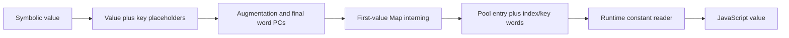

# Keyed constant pairs and values

## 1. Target

Every constant-bearing operand is finalized as two words: a pool index and a key. This mandatory
representation also permits optional concealment of string and integer pool values while runtime
loads materialize their ordinary values. This page closes the pair producer, pool-value equations
and shared reader at the pinned source. It does not qualify arbitrary JavaScript literal lowering
or values outside the preservation domains below.

Readers need arrays, Maps, JavaScript Number/bitwise coercion and UTF-16 code units. Read the
[package prerequisites](../js-confuser-vm.md#prerequisites-and-scope),
[container identity/width interface](../container-wordcode.md#augmentation-operand-handoff) and
[canonical grammar](../instruction-set.md#canonical-grammar). Constant pool values are JavaScript
values; the words identifying them are u32. String-bank concealment is a separate
[earlier producer](shared-string-bank.md), whose bank literal can itself use this representation.

## 2. Algorithm

Expand symbolic constants before measuring addresses. For each constant occurrence, retain the
original value operand and append a fresh constant operand with the same value and `key:true`.
Even when `concealConstants` is false, LOAD_CONST thus occupies opcode, destination, index and
key words. This prevents an option-dependent width change after branches have been resolved.

Later, after register/label resolution and augmentation, walk the constant operands in encounter
order. Intern their original values in a Map. First encounter assigns a pool index and, under
the truthy concealment gate, a nonzero random key for strings or integer Numbers. Equal later
values reuse both the pool entry and that key. Replace each occurrence in place with its numeric
index or key, preserving metadata and object identity used by baked operands and PATCH markers.

At execution, a shared constant reader consumes the index then key. Zero key returns the pool
entry. A keyed integer uses JavaScript XOR; a keyed string is inflated from base64 u16 little-
endian bytes and materialized by the position-dependent keystream. The compiler's instruction
comment helper uses the same value equations through Buffer; plaintext comments are consequently
possible even when stored constants are concealed.



The width is fixed by expansion, while the later pool walk determines actual stored values and
keys. Moving interning earlier would change encounter order under rearranging passes; moving
expansion later would invalidate already measured PCs.

### Synthetic exact example

Supply three LOAD_CONST operations with destinations r0/r1/r2 and values `"A\ud83d\ude00\u0000"`,
`-7`, and the same string again. Disable other transforms; choose first string key `0x80000001`
and integer key `0x80000001`. Expansion changes each symbolic tail `(dst,constant)` into
`(dst,constant,constant(key:true))`. First encounter allocates string index 0, then integer index
1; the third operation reuses index 0/key 2147483649. Each final instruction has four words:
`[0,0,0,2147483649]`, `[0,1,1,2147483649]`, `[0,2,0,2147483649]`.

The string has four UTF-16 units, including the two surrogate units of the astral character.
The following values use unsigned display for k; its actual `|0` state is signed int32.

| Unit index | Plain unit | k after Weyl step (u32 display) | ks | Stored unit |
|---:|---:|---:|---:|---:|
| 0 | 65 | 506952122 | 34817 | 34880 |
| 1 | 55357 | 3161387891 | 4100 | 51257 |
| 2 | 56832 | 1520856364 | 47135 | 26143 |
| 3 | 0 | 4175292133 | 8202 | 8202 |

Packing each stored unit low byte first yields base64 `QIg5yB9mCiA=`. The pool is therefore
`["QIg5yB9mCiA=",2147483640]`. Integer storage is `-7 ^ 2147483649 = 2147483640`; reading
it with that key yields -7. The string reader follows the same state sequence and XORs each
stored unit with ks to recover the four original units. With concealment false, the same index
reuse and four-word widths persist, but keys are zero and the pool contains the original values.
This is deterministic supplied IR/key arithmetic, not actual randomized compiler output.

## 3. Implementation

### Components and exact pair expansion

| Component | Input -> output | Consumer contract |
|---|---|---|
| Pair expander | Pre-pair IR -> adjacent constant occurrences | Run once before augmentation/label sizing; retain original instruction object. |
| Pool interner | Post-label operands/options -> stored values/index-key occurrences | First value encounter controls index/key; Map equality governs reuse. |
| String materializer | Stored base64 plus nonzero u32 seed -> UTF-16 string | Same step-before-XOR order and byte interpretation at storage/read. |
| Integer materializer | Stored Number/key -> signed int32 XOR result | Preservation guarantee requires original int32 value. |
| Runtime reader | Baked optional arguments or operand PC -> value/updated PC | Independently nullish arguments decide whether each word is consumed. |

For each instruction, inspect operands only, not its opcode. If any nonnull object has
`type:"constant"`, traverse all operands: append that original operand then a fresh
`{type:"constant",value:operand.value,key:true}` for every constant; otherwise append the operand
unchanged. Set the original instruction length to zero and refill it with opcode/new tail.
Instruction symbols survive this in-place rewrite. Null-op pseudo instructions are not specially
excluded. An existing `key:true` constant would be expanded again; this pass is not idempotent.
The real schedule runs it once, and anti-instrumentation constructs its own pairs afterward.

### Interning and storage decisions

Use fresh `constants=[]`, `constantsMap:Map<any,number>` and `keyMap:Map<number,number>`.
For every constant occurrence, including key-marked and hidden placeholder occurrences:

```text
explanatory procedure:
  v = operand.value
  if constantsMap.get(v) is not a number:
    idx = constants.length; constantsMap.set(v,idx)
    if options.concealConstants and typeof v is string:
      key = inclusiveRandomInteger(1,0xffffffff); stored = stringCipher(v,key)
    else if options.concealConstants and typeof v is number and Number.isInteger(v):
      key = inclusiveRandomInteger(1,0xffffffff); stored = v ^ key
    else:
      key = 0; stored = v
    constants.push(stored); keyMap.set(idx,key)
  else:
    idx = constantsMap.get(v); key = keyMap.get(idx)
  Object.assign(operand,{type:"number",resolvedValue: operand.key ? key : idx})
```

Map uses SameValueZero for primitive values and object identity for objects. Thus NaNs share an
entry, and +0/-0 share an entry; the stored plain value is the first encountered representative.
Concealment selects **all** Number.isInteger values, without an int32 range guard. For an int32
input, `(v ^ key) ^ key === v`; outside that domain the result is ToInt32(v), not necessarily v.
For example `2**32` materializes as 0 with any nonzero key, and -0 becomes +0. These are literal
source decisions/limitations, not invented refusal rules. Noninteger Numbers, booleans, null,
undefined and other values use key zero. Pool source serialization is separately owned by the
[container](../container-wordcode.md#constant-pool-and-emitted-binding-relationships); arbitrary
object/nonfinite preservation is not established by this private Map behavior.

The actual resolver creates replacement instruction arrays for instructions containing constants,
copies SOURCE_NODE_SYM and retains the operand objects through Object.assign. It does not delete
their `value`, `key`, `placeholder` or attached metadata. Instructions without constants are reused.
Finally assign `compiler.constants=constants`. The resolver performs no width expansion: source
comments suggesting a one-to-two expansion here do not describe its actual `map` operation.

### Exact string storage/read equations

The string cipher iterates UTF-16 indices `i=0..s.length-1`, with `k=key` initially:

```text
k = (k + 0x9e3779b9) | 0
ks = (k ^ (k >>> 13)) & 0xffff
e = s.charCodeAt(i) ^ ks
byte[2*i] = e & 255; byte[2*i+1] = (e >> 8) & 255
stored = Buffer.from(bytes).toString("base64")
```

`|0` wraps the state to signed int32; `>>>13` shifts its unsigned bit pattern. Empty strings
produce empty base64 yet still receive a nonzero key. No normalization, code-point iteration or
UTF-8 conversion occurs. Shared-bank strings use these same per-unit equations with a separate
seed for each bank entry; their positions do not advance the cipher before the entry starts.

For runtime `K(idxIn,keyIn)`, read `idx=idxIn ?? read()` then `key=keyIn ?? read()` independently;
`read()` increments the current frame's word PC. Fetch `v=constants[idx]`. If key is falsy, return v;
if v is numeric, return `v ^ key`; if v is non-string, return v. Otherwise obtain bytes using
Buffer when available, or `Uint8Array.from(atob(v),c=>c.charCodeAt(0))`. Iterate while
`i < bytes.length/2`, advance k/ks exactly as above, read
`e=bytes[2*i] | (bytes[2*i+1]<<8)`, and append `String.fromCharCode(e ^ ks)`.
No cache replaces the pool entry. Zero baked arguments suppress reads; null/undefined do not.
No pool/stream bounds or explicit even-byte-length check is made. Malformed base64 behavior comes
from the chosen host API. The compiler comment helper takes explicit index/key and uses Buffer
with the same equations; it does not advance runtime PC.

### State, publication and acceptance

The unit is private whole-source compilation, with no rollback or partial publication. Expansion
changes instruction widths; interning changes occurrence fields and compiler.constants. Subsequent
consumers require preserved operand identity and settled widths, rather than Babel binding state.
Runtime materialization advances PC only for unsupplied operands and does not mutate pool entries.

| Scenario | Observable result / oracle | Acceptance criterion | Evidence/control |
|---|---|---|---|
| K1 mandatory width/first intern | Exact example words/index/key reuse | False flag still expands; later resolution keeps width and hidden refs | [Frozen selected K1](#fixtures) and owner example; actual full finalizer missing |
| K2 UTF-16/full key | Unit/byte/base64 table and original four units | High key bit, surrogate units/NUL, step-before-XOR agree | [Frozen selected K2](#fixtures) and owner arithmetic; actual runtime/every-unit qualification missing |
| K3 numeric boundary | -7 preserved; 2**32 becomes 0 | Document actual gate/coercion, no imagined int32 rejection | [Frozen selected K3](#fixtures) and owner arithmetic; generated numeric boundary missing |
| K4 Map/identity | First -0/+0/object/hidden occurrence observations | SameValueZero versus object identity; Object.assign retains flags | [Frozen selected K4 operand/Map controls](#fixtures); complete finalizer graph missing |
| K5 reader consumption | Baked/missing arguments yield exact PC increments | Independently suppress each read; key zero still consumes unsupplied pair | [Frozen selected K5 scalar reader](#fixtures); actual runtime-state control missing |
| K6 composed bank/augmentation/PATCH | Final pool/words and materialized values agree | Earlier bank literals and baked/key placeholders follow actual schedule | Source dependency; retained composed output missing |

## 4. Later Stages

| Stage | Consequence |
|---|---|
| Anti after expansion | Its own pairs must not be expanded again. |
| Specialized/macro/alias | Hide, concatenate or permute both pair words; hidden occurrences still intern and mutate in place. |
| Labels before pool resolution | Addresses already include expanded pairs; later interning does not add words. |
| PATCH encryption after pool resolution | Final indexes/keys feed ciphertext; reordered encounters can change pool assignments. |
| Comments then minification | Comment helper can print materialized plaintext; final minifier may remove comments. |
| Runtime table/class/minification | Reader call sites/bindings may be rewritten; independent nullish read behavior still supplies the execution interface. |

## 5. Known Quirks

The gate conceals integer-valued Numbers outside int32 without preserving their original value.
Signed zero and first-representative Map behavior have the limits above. Cipher generation does
not remove plaintext instruction comments. Re-expansion is unsafe. Keys ride as plain operand
words rather than a separate secret store. This page specifies exact mechanism, not a cryptographic
security guarantee, complete literal lowering, host base64 conformance or generated-stack admission.

## Source

All links name `20c5b96bf57337c568579352758d7685358650de`.
Expansion is [concealConstants.ts#L4-L52](https://github.com/MichaelXF/js-confuser-vm/blob/20c5b96bf57337c568579352758d7685358650de/src/transforms/bytecode/concealConstants.ts#L4-L52);
storage/interning is [resolveConstants.ts#L19-L142](https://github.com/MichaelXF/js-confuser-vm/blob/20c5b96bf57337c568579352758d7685358650de/src/transforms/bytecode/resolveConstants.ts#L19-L142).
The runtime reader/byte provider are
[runtime.ts#L15-L21](https://github.com/MichaelXF/js-confuser-vm/blob/20c5b96bf57337c568579352758d7685358650de/src/runtime.ts#L15-L21) and
[runtime.ts#L182-L203](https://github.com/MichaelXF/js-confuser-vm/blob/20c5b96bf57337c568579352758d7685358650de/src/runtime.ts#L182-L203).
The comment helper is [compiler.ts#L2921-L2942](https://github.com/MichaelXF/js-confuser-vm/blob/20c5b96bf57337c568579352758d7685358650de/src/compiler.ts#L2921-L2942).
Mandatory/late positioning in items 2/4 is wired by
[compiler.ts#L3290-L3346](https://github.com/MichaelXF/js-confuser-vm/blob/20c5b96bf57337c568579352758d7685358650de/src/compiler.ts#L3290-L3346) and
[compiler.ts#L3379-L3436](https://github.com/MichaelXF/js-confuser-vm/blob/20c5b96bf57337c568579352758d7685358650de/src/compiler.ts#L3379-L3436).
Inclusive key sampling is [random-utils.ts#L24-L27](https://github.com/MichaelXF/js-confuser-vm/blob/20c5b96bf57337c568579352758d7685358650de/src/utils/random-utils.ts#L24-L27).

## Fixtures

No generated fixture or direct actual runtime/resolver control is retained here. The
[shared frozen-proof boundary](../symbolic-helper-assembly.md#frozen-selected-mechanics-proof-boundary)
owns protocol/manifest and common exclusions; the following index narrows credit to this page.

| Evidence | Scenario and selected assertion | Exclusion |
|---|---|---|
| Retired frozen verifier | K1-K5 selected pair changes, first-value Map/key reuse, UTF-16/empty/high-bit/int32/outside-domain results, hidden occurrence identity and baked/missing reader PC | Rebuilt scalar reader/interner; no actual encoder resolver/runtime/base64 host or complete finalizer state |
| Item 2 deterministic owner example | K1-K3 exact pair/pool/unit/base64 and integer equations | Generic arithmetic/Buffer calculation informed by source, separate from the cold proof |
| [concealConstants.test.js](https://github.com/MichaelXF/js-confuser-vm/blob/20c5b96bf57337c568579352758d7685358650de/test/options/concealConstants.test.js) | Hidden selected literals and expected-value upstream test intent | No fresh execution or retained generated bytes |
| No actual integrated control | Remaining K1-K5 actual resolver/reader state and K6 composition | Remain unverified |

The frozen tool models selected interning/width/object updates. It does not rebuild resolver
returned-instruction arrays, SOURCE_NODE_SYM copying or descriptor startPc state. Hidden/index/key
channel checks therefore cannot certify full finalization or serialization/publication. The
reader is a generic JavaScript mirror, not the VM's executed method. The owner example's original
inputs, keys and arithmetic oracles remain in item 2; neither evidence tier qualifies actual
compiler/runtime, host or generated/composed output.
