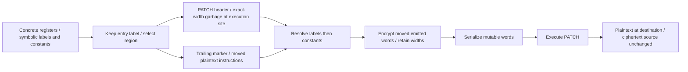

# Self-modifying wordcode regions and patch encryption

## 1. Target

Replace selected instruction runs with PATCH headers and same-width garbage, and move the real
runs to encrypted trailing storage. At runtime each real PATCH materializes its run back at its
execution address before execution reaches that address. Repeated entry rewrites the same words
from the unchanged encrypted source. This protects the initial executable stream's instruction
layout; it does not promise that every semantic value is absent from pools, baked handlers or
other output metadata.

Read the [workflow prerequisites](../js-confuser-vm.md#prerequisites-and-scope),
[container finalization/identity](../container-wordcode.md#augmentation-operand-handoff),
[canonical instruction semantics](../instruction-set.md) and the recipes for
[aliases](aliased-opcodes.md), [macros](macro-opcodes.md),
[specialized tuples](specialized-opcodes.md) and [anti-instrumentation](anti-instrumentation.md).
Readers need arrays, object identity, word PCs, control flow and JavaScript int32 bitwise coercion.
The runtime PATCH equation belongs to the
[instruction contract](../instruction-set.md#patch-debugger-and-dispatch-failure); this page owns
selection, routing, garbage construction, final-word encryption and their state interfaces.

Input is private post-register-resolution IR with settled augmented widths and expanded constant
pairs, but unresolved labels and constants. Construction returns a new instruction list containing
plain moved regions and operand-attached descriptors. Mandatory label/constant resolution then
precedes encryption, which replaces those regions in place with opaque u32 words. Serialization
publishes the mutable runtime stream only after the whole compilation succeeds. This is a pinned,
source-derived recipe with separate source-informed owner controls and a
[bounded document-only reconstruction](#fixtures) by one independent agent. That proof rebuilds
selected producer/encryption decisions with supplied scaffolds. Complete CFG safety, arbitrary-IR
validation, novice readability and generated-output qualification of selfModifying or its option
combinations remain unverified.

## 2. Algorithm

A label marks an address that other instructions can enter. Keep that label at the original
execution site. Collect the following run until a literal boundary instruction or pseudo record,
choose one to three contiguous regions within the run, and retain any unselected prefix/suffix.
For each selected region insert a five-word PATCH followed by exactly as many garbage words as
the region will emit. Keep the real instructions together elsewhere under a fresh label. The
PATCH's destination is the first garbage word, and its source interval is the moved run.

The original label now routes to the same program activity through a PATCH, rather than directly
to the first selected instruction. The PATCH finishes with PC pointing at the destination; it
requires no jump into that destination. Once the materialized run falls through, execution reaches
the next PATCH or retained suffix. Absolute label operands inside moved instructions are resolved
for their final execution targets; moving an instruction's storage does not make its encrypted
storage address an execution target. Instructions execute after copying, at destination addresses.

Create an arena of separately labelled junk blocks first, so decoy PATCHes can address its known
widths even before contents exist. Decoys occur inside garbage, after selected literal unconditional
terminators, and in trailing arena blocks. Every decoy source/destination interval is confined to
an arena block. Shuffle whole moved regions and whole junk blocks together; do not shuffle their
internal instruction order. Add further junk blocks until the instruction-entry growth floor is
met. The real-copy budget, inline-decoy budget and trailing floor count different things.

Construction must precede address measurement because it changes widths and label positions.
Encryption must follow labels and constants because even operand words need their final values.
The encryption state depends on the **destination**, not the shuffled source address, and advances
once per emitted word without resetting at instruction boundaries. Runtime uses the same stream
mask to materialize plaintext. Nonoverlapping real source/destination intervals leave ciphertext
unchanged, making ordinary repeated entry idempotent. The literal region classifier is weaker
than a general control-flow classifier; the precise limitations are in item 3 and item 5.



The two construction outputs meet again at finalization: the destination operand's shared object
supplies encryption's seed address, while the moved marker supplies the number of instruction
entries and emitted words to encrypt.

### Annotated synthetic example

This deterministic **synthetic assembly** supplies register resolution, plain canonical opcodes
and all random decisions; it neither imports nor runs the encoder. Use r0..r2 and this IR:

```text
defineLabel L
LOAD_INT r0,7                  words [1,0,7]
LOAD_INT r1,9                  words [1,1,9]
ADD r2,r0,r1                   words [11,2,0,1]
RETURN r2                      words [45,2]
```

RETURN is a literal region boundary. Choose two chunks, cutting after the second instruction:
A has two entries/six words; B has one entry/four words. Input length is five entries, including
L and RETURN; real budget is 100 and charge is (2+6)+(2+4)=14. Choose keyA=2147483653
(`0x80000005`) and keyB=4294967295. Replace A with two MOVE r0,r0 filler entries (six words)
and B with one ADD r0,r0,r0 filler entry (four words); these fillers never execute.

Choose three initial arena blocks, each 24 words, filled with twelve LOAD_THIS r0 entries.
Each adds thirteen entries including its marker. Disable all decoy chances in this example.
Real replacement adds 2+2 entries for A and 2+1 for B, so entriesAdded becomes 39+7=46.
Choose five further 24-word blocks of the same form: entriesAdded reaches 111, satisfying the
100-entry floor. This deliberately shows that 3..5 is the **initial** arena count, not a final
cap. Choose trailing order `junk_0,B,junk_1,A,junk_2,...,junk_7`:

| Word interval | Initial emitted content | Meaning |
|---|---|---|
| [0,5) | `[56,5,74,80,2147483653]` | PATCH A: destination 5, source [74,80), six words. |
| [5,11) | `[5,0,0,5,0,0]` | A's six garbage words. |
| [11,16) | `[56,16,46,50,4294967295]` | PATCH B: destination 16, source [46,50), four words. |
| [16,20) | `[11,0,0,0]` | B's four garbage words. |
| [20,22) | `[45,2]` | RETURN r2 remains in execution stream. |
| [22,46), [50,74), [80,224) | Each 24-word block is `[4,0]` repeated twelve times. | Eight distinct arena blocks; final interval contains six consecutive blocks. |
| [46,50) | B ciphertext `[2654177304,1013911572,3667965993,2027823165]` | B's four final plaintext words encrypted. |
| [74,80) | A ciphertext `[506955779,3161133061,1520744479,4175044618,2534529079,894267449]` | A's six final plaintext words encrypted. |

No marker occupies a word. L resolves to 0; A's moved label to 74; B's moved label to 46.
A's dest operand starts as `label(L,offset=5)`; the marker's descriptor points to that exact
object. Label resolution changes its type to number and sets resolvedValue=5 while retaining
identity and offset metadata. B analogously uses offset 16. The final stream has 224 words;
private construction has 116 entries, a growth of 111 over five. These numbers describe only
this fixed example, not a corpus measurement or general growth bound.

For A the initial signed encryption state is -2147483648. Successive states, displayed as u32,
are `[506952121,3161387890,1520856363,4175292132,2534760605,894229078]`; the state does not
restart between its two LOAD_INT instructions. B starts at -17 and has u32 states
`[2654435752,1013904225,3668339994,2027808467]`. Apply the producer equation in item 3 to the
listed plaintext and these states to obtain the exact ciphertext above.

Execution trace is `PATCH@0 -> LOAD_INT@5 -> LOAD_INT@8 -> PATCH@11 -> ADD@16 -> RETURN@20`.
The PATCH handlers leave PC 5 and 16, respectively; LOAD_INT finishes at 8 then 11; ADD finishes
at 20. R0=7, R1=9 and R2=16, so RETURN produces 16 using the canonical completion contract.
After materialization [5,11) equals `[1,0,7,1,1,9]` and [16,20) equals `[11,2,0,1]`.
A second invocation repeats both copies and the same result; all trailing words remain unchanged.
An exception after materialization would not restore initial garbage.

This example also exposes a useful seed control: changing keyA to 2147483652 changes the first
materialized destination word from 1 to 2, so a wrong key cannot be credited as successful
materialization even if a scaffolding interpreter happens to return something. It omits constants,
augmented handler execution, calls/captures, exceptions, transport, real random sampling, decoy
execution and actual public publication. Exact missing evidence is indexed in Fixtures.

## 3. Implementation

### Components, representations and order

| Component | Input -> output | Required consumer invariant |
|---|---|---|
| Region scanner/selector | IR plus OP/JUMP_OPS and counters -> prefix/chunks/suffix | Exact literal boundary and entry/word distinction; chunk cuts only between instruction entries. |
| Arena/decoy factory | Canonical OP plus labelled block widths -> filler/decoys | Exact filler width; every decoy interval remains inside an arena block. |
| Route/marker emission | Chunks and original label -> PATCH/garbage plus moved marker/run | Shared dest operand; instrCount counts entries, flatSize counts emitted words. |
| Label/constant finalization | Rebuilt lists and operand objects -> final numbers | Mutate objects without losing marker metadata/dest identity; no further width expansion. |
| Region encryption | Tagged final IR -> same-width opaque ciphertext | State continuous across each region's words; source labels/PCs unaffected. |
| Serialization/runtime | Opaque IR and matching handlers -> mutable data/execution | Pseudos/hidden refs omitted; runtime writes at destination before that run executes. |

`width(instr)` is zero for null-op pseudo records; otherwise it counts array elements whose
`placeholder` flag is not exactly true. `flatSize(run)=sum(width(instr))`. Those flags belong
to specialized operand refs, not to the garbage replacing a real run. A specialized tuple can
have a long private array and width one. The scanner never infers widths from opcode names.
The canonical and added-opcode handlers come from the linked dependencies; PATCH adds no
opcode allocation or new handler metadata.

A real marker is `[null,{type:"defineLabel",label:patchLabel,_patchRegion:descriptor}]`.
The descriptor is `{key,instrCount,flatSize,destPcOperand}`. It is attached to the marker's
operand, not the instruction array: label/constant resolution may rebuild arrays. The
`destPcOperand` is the same object present in the PATCH header. Decoy headers have no descriptor.
No position-keyed registry or instruction-array identity may replace this channel.

### Exact selection, counters and literal boundaries

Random `int(a,b)` is inclusive `floor(random()*(b-a+1))+a`; choice uses
`floor(random()*length)`, chance(p) means `random()<p/100`, and shuffle is in-place Fisher-Yates
from the last index down with `j=floor(random()*(i+1))`. There is no supplied seed API.
The following constants and accounting are consequential:

| Setting/state | Exact definition |
|---|---|
| PATCH width | Five emitted words: opcode,destPc,sliceStart,sliceEnd,key. |
| budget / charged | `max(input.length,100)` entries / starts zero; each real region adds `2+flatSize`. |
| entriesAdded | Starts zero; real region adds `2+placeholderEntryCount`; arena block adds `1+fillerEntryCount`; inline decoy run adds its entry count. |
| inlineDecoyBudget / added | `ceil(budget*0.2/2)` entries / starts zero; independent of charged. |
| Initial arena | int(3,5) blocks; each int(24,64) words. Extra blocks until entriesAdded>=100. |
| Chunks | Start `min(bodyEntryCount,int(1,3))`; never empty. |
| Real keys / counters | int(0,4294967295); patchCount/junkCount start zero and increment on label creation. |
| Inline trigger / run | chance(35) after literal terminator; int(1,2) entries; each chance(40) selects a decoy PATCH, otherwise filler(maxWidth=4). |
| Filler-stream decoy trigger | remaining>=5 and chance(25); consumes five words. |

The real charge conservatively bounds only **real-region entry growth**, since each garbage
entry has at least one word. It is not a global growth cap: arena and inline additions do not
spend charged. Inline insertion tests added<budget before drawing a run, so a two-entry run
can overshoot its cap by one. Floor top-up appends whole blocks and can overshoot 100.
No real candidate is required to reach that floor; even an empty/no-label input gets arena junk.

Recognize an entry label only when opcode is null and the first operand is a nonnull object
with type defineLabel. Keep its exact record. Collect consecutive following records until **any**
null opcode, one of JUMP_OPS, canonical RETURN, or input end. Do not include the boundary.
At the pin JUMP_OPS is precisely canonical JUMP, JUMP_IF_FALSE, JUMP_IF_TRUE, FOR_IN_NEXT,
TRY_SETUP and FINALLY_SETUP. Handler setup is included despite normal fallthrough. CALL,
CALL_METHOD, NEW, MAKE_CLOSURE, THROW and JUMP_REG are not collection boundaries.

```text
explanatory selection pseudocode (N is entry count; F is word count):
remaining = budget - charged
if N==0 or remaining<3: keep body
else:
  count = min(N,int(1,3))
  while count>1 and 2*count+F(body)>remaining: count--
  if 2*count+F(body)<=remaining:
    choose count-1 distinct cuts from 1..N-1; sort cuts
    chunks = contiguous slices between [0,cuts...,N]; prefix=suffix=[]
  else:
    start=int(0,N-1); length=int(1,N-start)
    region=body[start:start+length]
    while region has >1 entry and 2+F(region)>remaining: drop last entry
    if 2+F(region)>remaining: keep entire body
    else: prefix=body[0:start]; chunks=[region]; suffix=body[start+region.length:N]
```

A random single entry that is too wide is not replaced by another sampled candidate, even if
another would fit. When retaining a scanned body, advance to its boundary; do not rescan that
body or insert after-terminator decoys into its entries. A record processed by the outer scan
is emitted unchanged, then may receive inline junk only for the separate literal predicate
`op===OP.JUMP || op===OP.RETURN || op===OP.THROW || op===OP.JUMP_REG` (nonnull). Thus canonical
THROW/JUMP_REG inside a collected body receive no such insertion, even in an untouched body.

Added-opcode producers do not extend JUMP_OPS or canonical OP with their new numeric values.
An alias/specialized branch or RETURN, a macro ending in a transfer/call/RETURN, and anti's fake
branches therefore are not boundaries just because their metadata describes those effects.
They remain whole IR entries for sizing/movement. The pass has no metadata-aware terminator,
function ownership, reachability, overlap or interior-entry analysis. In particular, the source
comment that every region can only fall through into the next PATCH is not a property of this
classifier. A call can suspend in another frame before resuming the original destination PC;
a throw/return/branch can bypass later chunks entirely. The matching canonical/augmented semantics
must decide those paths; region selection alone is not their behavioral proof.

### Routes, exact-width garbage and decoy domains

Start emittedFlatSize at the retained prefix's word size. For each chunk with F words create
`patch_<originalLabel>_<patchCount++>`, sample its key, and emit:

```text
PATCH, label(originalLabel,offset=emittedFlatSize+5),
       label(patchLabel), label(patchLabel,offset=F), key
fillerStream(F)
trailing unit: marker(patchLabel, descriptor), ...original chunk entries
emittedFlatSize += 5+F
charged += 2+F; entriesAdded += 2+fillerEntryCount
```

Keep suffix entries, then continue the input scan. Once all scanning/top-up finishes, shuffle
trailing **units** and flatten one level after the execution list. Prefix/suffix/region entries
are reused, rather than cloned; garbage and marker/header arrays are new. Do not add an automatic
JUMP over trailing storage. Ordinary compiler functions end in RETURN (including implicit
undefined returns), and labelled branch/call entries retain execution-site labels. Under intact
execution, those completion/target contracts and overwrite-before-fallthrough keep storage junk
and unmaterialized fillers unexecuted. This expectation is not validation of arbitrary numeric
or computed targets or proof of all augmented combinations.

Filler shapes use only available numeric canonical OP entries from this closed table:

| Names | Operand kinds / width including header |
|---|---|
| TRY_END | none / 1 |
| LOAD_THIS | reg / 2 |
| MOVE, UNARY_NEG, UNARY_NOT, UNARY_BITNOT, TYPEOF | reg,reg / 3 |
| LOAD_INT | reg,int / 3 |
| ADD, SUB, MUL, DIV, MOD, BAND, BOR, BXOR, SHL, SHR, USHR, LT, GT, LTE, GTE, EQ, NEQ, GET_PROP | reg,reg,reg / 4 |

reg is int(0,24), int is int(0,65535); these are junk operands, not frame-regCount checks.
For filler(maxWidth), if maxWidth>1 select uniformly among shapes whose widths fit; if there
are no fits, emit `[choice(Object.values(OP).map(Number))]`. At maxWidth=1 this deliberately
bypasses even TRY_END and may emit the header of an operation requiring missing operands.
Filler is not generally executable code. LOAD_CONST/LOAD_GLOBAL/TYPEOF_SAFE are omitted from the
shaped table to avoid comment-listing constant decryption of garbage keys; the single-word
fallback can still choose their opcode alone.

`fillerStream(slots)` loops until zero remaining: take the decoy branch under the table's
condition, otherwise filler(remaining), decrementing by actual emitted width. Arena blocks are
`junk_<junkCount++>` markers plus fillerStream(sampled slots). Initial shells all exist before
filling any of them. A top-up shell is added to the same mutable arena array before it is filled;
future draws can select it while old decoys retain their prior targets.

For a decoy draw destination block then source block independently (they can coincide). Draw
`len=int(1,min(16,dst.slots,src.slots))`, source offset int(0,src.slots-len), destination offset
int(0,dst.slots-len), then key int(0,4294967295). Emit a normal PATCH header with labels/offsets
for those ranges. Source end is source start+len. It is left unencrypted, since no real-region
marker tags it. These ranges may overlap and contain instruction interiors. The canonical
mutable-stream PATCH equation still applies if executed; confinement proves arena write bounds,
not executable filler correctness or overlap idempotence.

### Finalization and encryption

Resolve labels with placeholder-filtered word widths. It uses Object.assign on existing label
operands, so the shared destination object and marker descriptor survive rebuilt instruction
arrays. Resolve constants next by writing through existing objects; expansion already happened,
so no width changes now. Function start PCs and added-opcode hidden operands/metadata are updated
through the container handoff. Junk creates no pool entries. Encounter order of moved instructions
after trailing shuffle can change first-interned constant indexes/keys; use those final results,
never values predicted before this shuffle.

Encryption scans null-op records; any truthy first-operand `_patchRegion` is treated as a region,
without separately checking its type or registry ownership. Require typeof destPcOperand.resolvedValue
number. Set k once per region, then process exactly instrCount **following entries**. Each target
must exist; flatten rejects a null opcode and, for each nonhidden element, requires either a
primitive number or object.resolvedValue number. Hide only operands after the header whose
placeholder===true. The precise producer equation for each emitted plaintext word w is:

```text
k = (key ^ destPc) | 0                 // initialization, once per region
k = (k + 0x9e3779b9) | 0             // before each word, continuous across entries
cipher = (w ^ (k ^ (k >>> 13))) >>> 0 // unsigned emitted word
```

JavaScript XOR and `|0` coerce to signed int32; `>>>13` shifts the unsigned form. `>>>0` converts
the result to u32. The maximum magnitude of the intermediate addition remains exactly representable
as a Number. The source address affects only which words runtime reads, not this state. This
producer equation composes with the linked canonical PATCH interpreter equation; no independent
runtime formula is defined here.

Replace each processed entry with `[cipher[0],...cipher.slice(1).map(numberOperand)]`, where
numberOperand is `{type:"number",resolvedValue:word}`; set the new array's opaque=true. Keep its
emitted instruction width, but remove hidden refs and other per-array metadata such as SOURCE_NODE_SYM.
Their final values remain available through compiler handler metadata where referenced there.
Do not reset k at an entry boundary. Require total encrypted words==descriptor.flatSize after
all replacements. The marker and its descriptor remain compiler-side; serialization drops null
records. `opaque` suppresses specialized-name interpretation during serialization, not all later
comment interpretation and not runtime numeric dispatch if execution wrongly enters storage.

### State, failure and publication

Construction returns a new list and leaves reused operand objects/entries shared with private
compiler state. It does not update register counts or redo liveness: registers were resolved
before moving entries. Label resolution updates function PCs/dest objects; constant resolution
updates the compiler pool and hidden metadata references. Encryption mutates its input list in
place and returns that same list. Repeating encryption is not an idempotent API: descriptors still
exist, so applying it twice would XOR its own ciphertext again. The scheduler calls it once.
Runtime repeated PATCH is different: it repeatedly reads stable ciphertext into a separate
execution destination, leaving the source intact.

| Failure | Exact boundary / private effect |
|---|---|
| Undefined label | Mandatory label resolver throws; no encryption/public result. |
| Unresolved destPc | `encryptPatches: unresolved destPc` before that region's writes. |
| Missing target entry | `encryptPatches: region runs past end of bytecode`; earlier entries/regions may already be encrypted. |
| Pseudo target | `encryptPatches: pseudo-op inside a patch region`; earlier replacements persist. |
| Unresolved emitted value | `encryptPatches: unresolved operand ...`; current flatten fails before replacing that entry. |
| Wrong descriptor flatSize | `encryptPatches: region size mismatch (<actual> != <expected>)` after region replacements. |
| Serializer/runtime build failure | Compilation rejects according to the container/publication contract. |

There is no matched-region transaction, rollback, unsupported-result tag or resumption protocol.
Type checks are not integer/range/finite checks, and descriptors are not a general damaged-input
validator. A fresh public compilation owns fresh compiler state; whole-source publication is
atomic in the sense that it returns no partial `code` result after failure. It does not undo private
mutations. Runtime materialization writes sequentially with no rollback on subsequent exception,
and shared mutable words persist across frame completion and invocations. Normal RETURN/capture
cleanup belongs to the canonical semantics; PATCH performs no frame/pool/helper cleanup and
publishes no independently reusable Babel scope graph.

### Testing and acceptance design

| Scenario | Observable result / oracle | Acceptance criterion | Evidence/control |
|---|---|---|---|
| P1: chunks, destinations, continuous cipher state | Item 2 exact words and PC/value traces versus canonical LOAD_INT/ADD/RETURN | Two sources map to original execution intervals, complete reads, high-bit/zero/maximum key arithmetic, unchanged sources on repeated entry. | [Bounded verifier](#fixtures): selected construction/encryption, exact words and supplied tiny execution oracle; owner assembly separate. Actual runtime/generated invocation missing. |
| P2: selection/counters | Scripted entry widths and decisions versus selection pseudocode | Whole-fit chunk decrement, distinct sorted cuts, fallback trimming/nonfit preservation; real charge separate from floor/inline overshoot. | [Bounded verifier](#fixtures): selected count decrement, cut, fallback, nonfit, counters, empty input and inline overshoot; owner controls separate. Full sampling/populations/generated budgets missing. |
| P3: literal boundaries and suspension | OP/JUMP_OPS plus canonical/augmented semantics | Distinguish region end from inline decoy trigger; don't infer a hidden branch boundary; calls resume original destination PCs and captures remain correct. | [Bounded verifier](#fixtures): literal predicates and scanned THROW insertion decision only; owner predicates separate. Actual calls/capture/exception/augmented execution missing. |
| P4: garbage/decoys | Exact filler widths, clamped arena intervals and mutable PATCH oracle | No slot overrun; same-block/overlap allowed; no real source/destination write; top-up shell availability correct. | [Bounded verifier](#fixtures): selected filler/fallback and clamped/overlapping decoy factory decisions; supplied mutable-copy/empty-interval oracle. Actual decoy execution/full sampling/top-up targeting missing. |
| P5: width/identity/opaque state | Hidden-ref resolution, descriptor identity and serialized widths | Rebuilt arrays retain descriptor/dest identity; encryption removes hidden refs, preserves PCs and bypasses specialized rename on ciphertext collision. | [Bounded verifier](#fixtures): supplied finalizer identity/hidden width and limited opaque serializer gate; owner state control separate. Complete resolver/metadata graph/hidden validation/generated evidence missing. |
| P6: named failures/publication | Valid surrounding record reaches each named assertion | Record exact partial private mutation and whole-public rejection; no claimed rollback. | [Bounded verifier](#fixtures): rebuilt named private error messages and partial replacement only, for producer integer counts. Actual AssertionError/publication outcomes remain unexecuted. |
| P7: generated/combined representations | Frozen source/options/output/provenance and program plus state/effect oracle | Observe real PATCH and each credited option effect; behavior, words, routes, widths, pool/handler metadata and completion state agree. | One upstream option test's intent; retained generated/fresh combined evidence missing. |

### Annotated source-informed controls

These controls were executed with standalone JavaScript arithmetic, array and object operations
on Node v26.9.0, without encoder imports/execution. Inputs and expected results below are retained so an independent
review can rebuild a bounded check. They are additional **owner** evidence, not a cold proof.

| Control inputs | Expected result / decision exercised |
|---|---|
| Item 2 complete stream; apply the canonical PATCH operation twice, with source snapshots | Both destination slices equal listed plaintext; both invocations return 16 with PC trace 0,5,8,11,16,20; all source/arena words unchanged. Wrong keyA=2147483652 yields first word 2, not 1. |
| Plaintext [0,1,2147483648,4294967295], keys 0/2147483653/4294967295, destinations 0/5/16 | Applying the producer XOR twice with the same key/destination recovers every supplied u32 word; zero key still produces a nontrivial mask. This checks arithmetic symmetry, not runtime overlap. |
| widths [3,3,4], count=3, remaining=14 | Decrement count to 2; whole-fit charge 14. A cut at entry 2 gives the example's 6/4-word split. |
| widths [3,4,2], remaining=7, start=1,length=2 | Whole-fit fails; trim [4,2] to [4], charge 6; prefix [3], suffix [2]. At remaining=5 and start=1,length=1 retain whole body, though a different entry would fit. |
| budget=100, inlineAdded=9, cap=10, chosen run=2 | Precheck admits run; inlineAdded becomes 11. Example arena/real growth sequence 39+7+5*13=111. |
| Every canonical OP name plus added codes 61..64 representing alias JUMP, special RETURN, macro terminal RETURN, anti fake branch | Region-end set exactly JUMP,JUMP_IF_FALSE,JUMP_IF_TRUE,FOR_IN_NEXT,TRY_SETUP,FINALLY_SETUP,RETURN. Inline-trigger set exactly JUMP,RETURN,THROW,JUMP_REG. Added codes satisfy neither; CALL/THROW/JUMP_REG satisfy no region-end predicate. |
| width-one special `[61,hidden(dst=2),hidden(idx=7),hidden(key=0)]`; dest label object shared by marker/header; chosen key=5,dest=8 | After in-place resolution/rebuilt arrays, dest identity remains. Emit only [61]; ciphertext is [2654177344], one opaque word. Metadata refs still hold 2,7,0 while encrypted entry has no hidden refs. Choose plaintext `2654177405 ^ 61` for this mask to make ciphertext header exactly 61; opaque serialization leaves OP_NAME[61] unchanged instead of renaming it. |
| src/dst slots 24/64, len=16, offsets src=8,dst=48; same-block slots=24,len=16,offsets 0/8 | First source/destination ends are 24/64; second ends are 16/24 and overlap. Both are legal decoy interval bounds; neither implies a snapshot-copy or idempotence contract. |

A negative control must reach its named choice/assertion. Wrong keys test word equality before
execution; bogus widths must reach the final size assertion rather than an earlier unresolved
operand. A stream that ends after arithmetic without RETURN could fall into trailing storage;
its failure would demonstrate the missing completion prerequisite, not an encoder-produced case.

## 4. Later Stages

| Later stage / emitted spelling | Effect on this output/interface |
|---|---|
| Label then constant resolution | Final absolute execution/source addresses and pool index/key words; shared operand mutation closes encryption inputs. |
| Encryption | Moved instruction entries become opaque ciphertext of identical emitted widths; pseudo metadata stays compiler-side. |
| Serializer / raw or encoded transport | Drops markers, filters placeholders, validates numeric/range values, suppresses specialized renaming for opaque arrays; runtime materializes the same word-indexed data. |
| Specialized -> macro -> alias -> anti runtime builders | Existing compiler metadata installs handlers for plaintext later materialized at destinations; ciphertext is not an added-opcode census. Hidden specialization refs remain in metadata. |
| Case shuffle -> handler table -> class -> minify | PATCH body/dispatch and container bindings can move/lift/rename/fold; five-word header and mutable stream effects persist through matching runtime contracts. |
| Comment generation | Reads private IR after encryption/runtime naming. Cipher arrays lose original source-node metadata; opaque is not a universal comment-generation guard. Comments are not proof of storage instruction meaning. |

The preceding augmentation and concealment/control stages determine the IR this pass receives.
Their names alone cannot prove its region reachability. This page's scanner accepts settled widths
without widening its literal transfer sets; actual composed execution requires P3/P7 evidence.

## 5. Known Quirks

- The conservative real-region charge is not a total code-growth limit. Initial arena size is
  not the final arena count; inline insertion can overshoot its cap by one entry and top-up
  can exceed the floor. No-candidate construction still adds junk.
- Literal JUMP_OPS is neither all transfers nor only transfers. THROW/JUMP_REG/calls and
  augmented transfer values can remain inside moved chunks; handler setup stops them.
  Chunks can stop or suspend instead of immediately falling through. No observed generated
  failure is inferred from that classification, and complete composed safety remains unproved.
- Garbage is exact-width storage, not a valid program. One-word fallback may be any canonical
  header; shaped registers need not fit the current frame. Intact completion/entry routing
  and materialization prevent normal execution of that garbage, rather than opcode names.
- The runtime checks no bounds/ownership or overlap. Real construction supplies disjoint storage
  and destinations; decoys may overlap within junk and follow sequential mutable-read semantics.
  Arbitrary malformed IR/metadata or host mutation of bytecode has no preservation guarantee.
- Encryption is one-shot, in place and can fail after partial private replacement. It preserves
  emitted boundaries, not hidden refs or per-array provenance. `opaque` only guards the specified
  serializer interpretation; listing or incorrectly entered ciphertext can still look like
  an opcode by numeric collision. No cryptographic strength claim is made.
- The [bounded cold verifier](#fixtures) rebuilds selected P1-P6 decisions for producer-created
  integer-count regions with deterministic/sparse infrastructure. Its private Error messages and
  partial mutations do not establish actual AssertionError types or whole public publication.
  Supplied resolver/serializer/value oracles do not prove the real metadata graph, hidden-value
  validation, frame/capture/exception cleanup or augmented handler execution. Fractional damaged
  counts fall outside its admitted boundary and differ from the source loop. Full random selection,
  host effects and real generated stacks remain open. The separate owner controls are source-informed;
  neither evidence set establishes novice readability or whole-compiler reconstruction.

## Source

All links name `20c5b96bf57337c568579352758d7685358650de`. Construction constants, marker
representation, selection, filler/decoy generation and accounting in items 2-3 are
[selfModifying.ts#L11-L183](https://github.com/MichaelXF/js-confuser-vm/blob/20c5b96bf57337c568579352758d7685358650de/src/transforms/bytecode/selfModifying.ts#L11-L183)
and [selfModifying.ts#L220-L463](https://github.com/MichaelXF/js-confuser-vm/blob/20c5b96bf57337c568579352758d7685358650de/src/transforms/bytecode/selfModifying.ts#L220-L463).
Final-word flattening, encryption, opaque replacement and errors are
[encryptPatches.ts#L17-L84](https://github.com/MichaelXF/js-confuser-vm/blob/20c5b96bf57337c568579352758d7685358650de/src/transforms/bytecode/encryptPatches.ts#L17-L84).
Literal boundary values and ordinary function completion are
[compiler.ts#L419-L430](https://github.com/MichaelXF/js-confuser-vm/blob/20c5b96bf57337c568579352758d7685358650de/src/compiler.ts#L419-L430)
and [compiler.ts#L667-L683](https://github.com/MichaelXF/js-confuser-vm/blob/20c5b96bf57337c568579352758d7685358650de/src/compiler.ts#L667-L683).
Wiring is [compiler.ts#L3395-L3458](https://github.com/MichaelXF/js-confuser-vm/blob/20c5b96bf57337c568579352758d7685358650de/src/compiler.ts#L3395-L3458),
forcing item 4's construction/finalization/encryption order; serializer opacity and comment behavior
are [compiler.ts#L2940-L3141](https://github.com/MichaelXF/js-confuser-vm/blob/20c5b96bf57337c568579352758d7685358650de/src/compiler.ts#L2940-L3141)
and [compiler.ts#L3158-L3198](https://github.com/MichaelXF/js-confuser-vm/blob/20c5b96bf57337c568579352758d7685358650de/src/compiler.ts#L3158-L3198).
Width, random primitives, mutable operand types and finalization channels are
[op-utils.ts#L41-L47](https://github.com/MichaelXF/js-confuser-vm/blob/20c5b96bf57337c568579352758d7685358650de/src/utils/op-utils.ts#L41-L47),
[random-utils.ts#L7-L39](https://github.com/MichaelXF/js-confuser-vm/blob/20c5b96bf57337c568579352758d7685358650de/src/utils/random-utils.ts#L7-L39),
[types.ts#L54-L94](https://github.com/MichaelXF/js-confuser-vm/blob/20c5b96bf57337c568579352758d7685358650de/src/types.ts#L54-L94),
[resolveLabels.ts#L29-L111](https://github.com/MichaelXF/js-confuser-vm/blob/20c5b96bf57337c568579352758d7685358650de/src/transforms/bytecode/resolveLabels.ts#L29-L111)
and [resolveConstants.ts#L45-L142](https://github.com/MichaelXF/js-confuser-vm/blob/20c5b96bf57337c568579352758d7685358650de/src/transforms/bytecode/resolveConstants.ts#L45-L142).
The runtime read/write implementation is
[runtime.ts#L879-L892](https://github.com/MichaelXF/js-confuser-vm/blob/20c5b96bf57337c568579352758d7685358650de/src/runtime.ts#L879-L892);
its canonical equation/invalid-address semantics remain owned by the linked instruction contract.
Added-opcode restrictions and matching runtime assembly remain owned by the linked augmentation
pages; their Source sections are the dependency provenance, not claims of extra source ownership here.

## Fixtures

| Retained input/control | Scenario / claim | Evidence boundary |
|---|---|---|
| Retired frozen bounded verifier | P1/P2 selected producer/encryption/selector/counter decisions; P3 literal predicates; P4 selected filler/decoy bounds; P5 supplied identity/width/opacity; P6 rebuilt named private messages/partial replacement | Independent one-agent document-only reconstruction before source consultation, within the scaffold/integer-count boundary below; no actual runtime/compiler/publication/generated qualification. |
| Item 2 deterministic assembly and item 3 annotated controls | P1/P2/P3/P4/P5 selected routing/cipher/PC/value, repeat-copy, budget/fallback, literal predicate, interval and identity/opaque decisions | Source-informed owner calculations with exact supplied data/choices; no encoder/runtime import, cold/novice proof or generated-option qualification. |
| [selfModyfing.test.js](https://github.com/MichaelXF/js-confuser-vm/blob/20c5b96bf57337c568579352758d7685358650de/test/options/selfModyfing.test.js) | P7 intent: explicit selfModifying=true, PATCH/comment presence and a called function's expected window result | Generates at test time, asserts neither exact regions/keys/decoys nor repeated calls/internal state/all option effects. Not run here. |
| No retained direct input/control | P3 actual call/capture/exception/augmented execution; P4 executed decoys; P5 complete resolver graph/hidden validation; P6 actual source error types/publication; P7 generated stacks | Acceptance remains unverified for these cells. |

The frozen tool retains its exact synthetic inputs, deterministic decisions, reconstructed code
and supplied oracle. Its
admitted descriptor instrCount is the integer chunk length produced by construction. The rebuilt
one-based entry loop agrees within that boundary, but differs from source zero-based n<instrCount
for fractional damaged metadata. Its throws are Error, whereas source assert.ok produces
AssertionError: P6 credits named message reachability and earlier-entry replacement, not exception
constructor, stack/code or actual public failure. Neither branch grants arbitrary damaged-IR support.

Deterministic semantic choice overrides and a sparse OP map replace actual random sampling and
Fisher-Yates; they prove selected admissible factory/selector decisions, not a seeded upstream replay
or complete filler populations. The small finalizer rebuilds arrays while sharing operands and
supplies simple labels/string constants with key zero. Its indexOf pool is not the real Map graph
or SameValueZero behavior for NaN, and it omits label transforms, descriptors, register allocation,
concealment and general metadata consumption. The hidden control supplies register 2 and pool
index 0/key 0; the owner's separate annotated control supplies index 7. Neither executes a
specialized handler. The limited serializer checks emitted words and the opaque naming gate,
without the source's numeric/range and hidden-ref validation, annotations, comments or transport.

The tiny supplied interpreter implements only LOAD_INT/ADD/RETURN/PATCH as an independent value/PC
oracle. RETURN does not implement actual frames, captures or exception cleanup. Its step bound and
unsupported-opcode errors are scaffolding. The mutable-overlap/empty-interval check likewise executes
a supplied PATCH oracle, not the real runtime. Full random/multi-cut populations, multiple-function
fallback routing, top-up-shell targeting, actual resolver/augmented/call/suspension/exception behavior,
publication, runtime reshaping and retained generated source/options/output remain unverified.
This bounded reconstruction is not a novice study or source equivalence for every private input.

The test generates via
[test-utils.js](https://github.com/MichaelXF/js-confuser-vm/blob/20c5b96bf57337c568579352758d7685358650de/test/test-utils.js);
explicit override options replace the global profile, rather than merge into it. The misspelled
committed test filename above is intentional. There are no retained encoder-generated PATCH
fixture bytes in this package and no fresh execution of that upstream test or new qualification.
