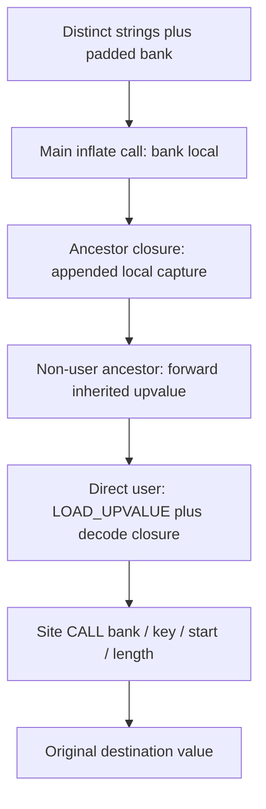

# Shared string-bank concealment

## 1. Target

String concealment replaces eligible string LOAD_CONST sites with calls that materialize a slice
of one padded, encoded bank. The program's main frame inflates that bank once per main invocation;
descendant virtual closures obtain the same value through ordinary captures. This page specifies
the bank, helper algorithms and emitted capture/call representation at the pin. It does not
qualify all host facilities, syntax forms or combinations.

Readers need arrays, strings, closures/captures and UTF-16. Read the
[package prerequisites](../js-confuser-vm.md#prerequisites-and-scope),
[shared helper assembly](../symbolic-helper-assembly.md),
[keyed constant equations](keyed-constants.md#exact-string-storageread-equations) and
[MAKE_CLOSURE/capture contract](../container-wordcode.md#frame-and-capture-state).
Raw helper lowering is supplied compiler infrastructure. Helpers are ordinary virtual functions,
not additional runtime AST transforms.

## 2. Algorithm

Scan the original function bodies to collect distinct eligible strings, their direct-user
functions and the lexical creation edges recorded by MAKE_CLOSURE. An eligible site is exactly
`[OP.LOAD_CONST,dst,{type:"constant",value:string}]`, length three. Thus this pass must precede
constant-pair expansion. Walk each direct user's ancestors: even an ancestor with no strings
needs to pass the bank capture onward.

Concatenate encrypted UTF-16 strings in first encounter order, with random decoy units before,
between and after payloads. Record `(key,start,length)` per original string, where start/length
count UTF-16 bank units, not bytes or code points. Pack the complete bank as u16 little-endian
bytes and base64. Duplicated strings share one entry/seed/slice, while sites keep separate calls.

Compile two shared helper function bodies: inflate converts base64 bytes to the bank's u16 units;
decode takes bank, seed, start and length, runs the per-entry keystream starting at iteration zero,
and produces the original slice value. Main creates an inflate closure, loads the base64 constant
and calls it into a new local register. Each direct user creates a decode closure in its own
frame. Non-main direct users first load the inherited bank upvalue into a local register.

Append one capture pair to every original MAKE_CLOSURE whose child needs the bank. Main captures
its bank local; further ancestors forward their inherited upvalue index. Each eligible load becomes
three LOAD_INT operations for key/start/length and one four-argument CALL writing the original
destination. Append the shared helper bodies after all original function bodies. No bank global
is installed and there is no per-string cache or helper body per string site.



The capture path is necessary because bank storage belongs to main's frame. Ordinary upvalue
closing preserves it when a closure escapes; the pass relies on the canonical capture lifecycle,
not special bank lifetime rules.

### Synthetic bank and capture example

Supply strings `"A"`, `"B"`, `"A"` in encounter order. Choose 100 leading decoys of unit 0x1234,
a first gap of two 0x5555 units, zero gap before B, 100 trailing 0x1234 units, seed 1 for A and
0xffffffff for B. These choices lie within the actual draw ranges; fixed repeated decoy values
are deterministic synthetic selections. Bank positions 0..99 are leading decoys, 100..101 the
first gap, position 102 is A's encrypted unit 34880, and 103 is B's encrypted unit 34881.
Trailing decoys occupy 104..203. The bank has 204 units/408 packed bytes. A's entry is
`(1,102,1)`; B's is `(4294967295,103,1)`; the second A shares the first entry.

For A, k advances from 1 to 2654435770, ks=34817 and `34880 ^ 34817 = 65`. For B,
k advances from 4294967295 to 2654435768 modulo 2**32, ks=34819 and
`34881 ^ 34819 = 66`. Inflate reads low/high byte pairs; decode indexes bank at start+i,
but advances the cipher from each entry's seed at i=0. Leading decoys do not advance that state.

Separately supply creation chain main -> A -> B, with only B using strings, original A capture
count 1 and B capture count 2. needSet includes all three. Assign A bank index 1 and B bank
index 2 before helper compilation. Main's A creation changes uvCount 1 to 2 and appends
`(1,mainBankRegister)`; A's B creation changes 2 to 3 and appends `(0,1)`. B loads its bank
from upvalue 2, creates decode and calls it with the entry triple. A needs no bank load or decode
closure merely to forward index 1. The original descriptor `upvalues` lists stay length 1/2;
the changed runtime counts live in the emitted MAKE_CLOSURE operands. This example supplies
descriptor/creation metadata and does not claim exact raw lowering or final physical slots.

## 3. Implementation

### Components and representations

| Component | Consumes -> produces | Consumer invariant |
|---|---|---|
| Prescan | Original entries/LOAD_CONST/MAKE_CLOSURE -> string Set, directUser, parentOf | Original descriptor inventory defines function attribution and capture indexes. |
| Need propagation | Direct users/creation parents -> ancestor closure | Every route to a user can carry a bank upvalue. |
| Bank builder | Ordered distinct strings/random choices -> u16 bank/table/base64 | Entry slices use unit indexes; cipher resets per entry. |
| Helper assembly | Exact inflate/decode algorithms -> shared virtual bodies/descriptors | Helpers have params 1/4, no captured bank; bank is an explicit argument. |
| Prologue/threader | Need/direct-user sets/original counts -> bank initialization/captures | Main local versus parent upvalue flags remain distinct. |
| Site rewrite | Eligible load/table entry -> three immediates plus CALL | Result writes original destination identity after complete argument collection. |

### Exact prescan and bank construction

Snapshot descriptor `entryLabel -> _fnIdx`, entries and `mainFn._fnIdx`. Start curFn=-1;
each recognized entry updates curFn and continues. Ignore instructions before any entry.
An exact string load adds its `.value` to a Set and curFn to directUser. Otherwise, for
MAKE_CLOSURE use operand 2's label to find childId and assign `parentOf[childId]=curFn`.
The prescan does not inspect capture pairs or verify a unique parent; repeated creation entries
overwrite parentOf. If no string is found, return original IR without helpers or bank state.

For each direct user, walk parentOf until undefined or a previously needed function; add every
visited fnId. For each needed non-main function set bankUvIndex to its **original** descriptor
upvalues length (or zero if absent). This happens before compiling helpers. Scan current IR
for maxima and allocate main bank register using the shared fresh-ID contract.

Bank construction, in order:

1. Add `getRandomInt(100,250)` leading decoys; each unit independently draws 0..65535.
2. For each Set string, add a gap of `getRandomInt(0,5)` decoys, including before the first
   payload. Choose key in 1..0xffffffff; encrypt with the
   [exact per-unit cipher](keyed-constants.md#exact-string-storageread-equations). Save start as
   the current unit count and length as `str.length`, then append encrypted units.
3. Add another 100..250 decoys. Pack each bank unit as low byte then high byte; base64 the bytes
   with Buffer. Even an eligible empty string causes bank/helpers, receives a key/zero length,
   and contributes a gap but no payload units.

Integer draws are inclusive; choice/chance/shuffle use the
[shared primitive equations](runtime-layout.md#components-and-exact-allocation). No security
claim follows from the randomized padding or choice of PRNG.

### Exact helper behavior and instruction emission

The inflate helper accepts s, calls host `atob(s)` to obtain a byte string, starts out="", and
for i=0 while `i < bytes.length`, stepping by 2, appends
`String.fromCharCode(bytes.charCodeAt(i) | (bytes.charCodeAt(i+1)<<8))`. Return out. This helper
uses atob directly, unlike the keyed constant reader's Buffer fallback; the host dependency is
therefore consequential even in Node environments. Generated banks have even byte lengths.

Decode accepts `(bank,key,start,length)`, initializes result="", and for i=0 while i<length
increments i by one: advance key by `(key+0x9e3779b9)|0`, form
`ks=(key^(key>>>13))&0xffff`, append
`String.fromCharCode(bank.charCodeAt(start+i)^ks)`. Return result. Its property/global calls
are compiled virtual instructions using host atob/String and the bank's string methods. The
helper body is shared, but each direct user's prologue creates a closure referencing that body.
Helper source itself is not recursively concealed by this pass; later CFF/dispatcher see it.

Use MAKE_CLOSURE tail `(dst,label(entry),params,fnRegCount(helperId),0,0)` for these helpers.
For a function not in needSet, return its body unchanged. For main emit:

```text
explanatory symbolic instructions, each ref is a fresh occurrence:
MAKE_CLOSURE rInflate, inflateEntry, 1, fnRegCount(inflateId), 0, 0
LOAD_CONST rB64, constant(bankBase64)
CALL rBankMain, rInflate, 1, rB64
```

For a non-main direct user, emit `LOAD_UPVALUE rBank,bankUvIndex[fnId]`.
For every direct user (including main), create rDecode using params 4 and allocate rKey/rStart/
rLen. Ancestors that are not direct users allocate none of these per-user registers.

In the original body, MAKE_CLOSURE to a known needed child increments operand 5 (uvCount) and
appends `(1,ref(rBankMain))` in main or `(0,bankUvIndex[parentFnId])` elsewhere. It does not
modify descriptor.upvalues or recompute existing capture pairs. Its appended register object is
freshly constructed for that function callback's childUpvalue pair and reused by its qualifying
creations; the implementation does not fresh-copy that pair for each site. This special occurrence
sharing is source behavior, so the general fresh-ref safety rule must not erase it from a model.

Replace a string load with `LOAD_INT rKey,key; LOAD_INT rStart,start; LOAD_INT rLen,length;`
`CALL originalDst,rDecode,4,rBank,rKey,rStart,rLen`, using fresh refs. Preserve noncandidate
instructions. Prologue precedes original body, after its retained function entry marker. Append
inflate/decode helper IR after function partitioning. Original replaced load source symbols are
not transferred to these new instruction arrays.

### State, boundaries and acceptance

The pass changes private IR, emitted closure capture counts and shared descriptors appended by
Template. It does not grow original descriptor upvalue arrays, rewrite Babel bindings or publish
a bank global. Register/label/count resolution later turns the emitted capture/register operands
into slots/PCs. Runtime bank value is held by normal upvalue cells and survives escaped closures;
normal capture closing/frame release follows canonical semantics. No per-site transaction,
rollback, cache, retry or malformed creation-graph validator is implemented. Public failure and
whole-source publication follow the [container boundary](../container-wordcode.md#emitted-forms-failures-and-publication).

| Scenario | Observable result / oracle | Acceptance criterion | Evidence/control |
|---|---|---|---|
| S1 eligibility/no work | Exact length-three string loads versus pair/nonstring forms | No candidates returns original IR and descriptor inventory | [Frozen selected S1 controls](#fixtures); actual producer control missing |
| S2 bank layout/materialization | Supplied bank positions/units and decoded A/B | Inclusive decoys, dedup, UTF-16 start/length, cipher reset | [Frozen selected S2 arithmetic](#fixtures) plus owner example; actual producer/helper missing |
| S3 capture ancestry | main -> non-user A -> user B operands/counts | Original-count indexes; local then inherited pairs; descriptors stay unchanged | [Frozen selected S3 pairs/counts](#fixtures) and owner graph; actual descriptor/capture state missing |
| S4 empty/Unicode/duplicate | Exact original unit strings from supplied seed/slice | Zero length and surrogate units preserved; duplicates reuse entry | [Frozen selected S4 slice/dedup](#fixtures); keyed Unicode oracle separate; generated bank edges missing |
| S5 prologue/site order | Bank initialized before creations/site calls; original dst result | One main inflate per invocation, per-user closure, fresh argument refs | [Frozen selected S5 call shape](#fixtures); per-site scratch/ref scaffold differs; actual slots/helpers missing |
| S6 composed protections | Bank/helpers/closures agree after CFF/dispatcher/keying/PATCH | Each credited effect executes with capture/PC/state oracle | Source-derived dependency; retained composed output missing |

## 4. Later Stages

| Later stage | Effect on these forms |
|---|---|
| CFF then dispatcher | Can transform original and newly appended helper bodies; their branches/temporaries participate normally. |
| Mandatory pairs/value concealment | Bank base64 and helper/property-name constants become pairs; the bank literal may be concealed again. |
| Augmentation | New calls/immediates/closures can alter candidate populations; operand identity/width contracts still apply. |
| Register/count/label resolution | Appended local captures get concrete source slots; helper fnRegCount and entry labels resolve. |
| Runtime representation/minify | Virtual bank helpers remain executed through canonical calls even if runtime bindings change spelling. |

## 5. Known Quirks

Only exact LOAD_CONST strings are replaced. The pass assumes the compiler's lexical creation
graph and original capture inventories; it does not enforce one parent, detect arbitrary cycles
or synchronize descriptor counts. Child local-capture occurrence sharing is retained as described.
Helper inflate calls atob directly; host support/monkey-patching can affect it. Cipher and helper
string/property names may remain visible in later-generated comments. Length/start/key operands
and bank padding are concealment representation, not a cryptographic security proof.

## Source

All links name `20c5b96bf57337c568579352758d7685358650de`.
Cipher/bank/predicate are [stringConcealing.ts#L71-L148](https://github.com/MichaelXF/js-confuser-vm/blob/20c5b96bf57337c568579352758d7685358650de/src/transforms/bytecode/stringConcealing.ts#L71-L148);
prescan/need/indexes are [stringConcealing.ts#L151-L208](https://github.com/MichaelXF/js-confuser-vm/blob/20c5b96bf57337c568579352758d7685358650de/src/transforms/bytecode/stringConcealing.ts#L151-L208);
helpers/emission are [stringConcealing.ts#L210-L329](https://github.com/MichaelXF/js-confuser-vm/blob/20c5b96bf57337c568579352758d7685358650de/src/transforms/bytecode/stringConcealing.ts#L210-L329).
Shared assembly is [template.ts#L84-L175](https://github.com/MichaelXF/js-confuser-vm/blob/20c5b96bf57337c568579352758d7685358650de/src/template.ts#L84-L175) and
[pass-utils.ts#L10-L126](https://github.com/MichaelXF/js-confuser-vm/blob/20c5b96bf57337c568579352758d7685358650de/src/utils/pass-utils.ts#L10-L126).
The first-pass position forcing pristine capture indexes/eligibility in items 2/4 is
[compiler.ts#L3290-L3315](https://github.com/MichaelXF/js-confuser-vm/blob/20c5b96bf57337c568579352758d7685358650de/src/compiler.ts#L3290-L3315).

## Fixtures

No retained generated bank or direct actual helper/capture-state fixture is supplied here. The
[shared frozen-proof boundary](../symbolic-helper-assembly.md#frozen-selected-mechanics-proof-boundary)
owns protocol/manifest and common exclusions.

| Evidence | Scenario and selected assertion | Exclusion |
|---|---|---|
| Retired frozen verifier | S1-S5 selected exact eligibility/no-work controls, bank slices/table/dedup, original-count ancestor pairs and site-call logical destination | Supplied helpers/scalar bank oracle; no exact scratch/ref/descriptor fidelity or real captures/frames/host |
| Item 2 owner example | S2/S3 bank choices/positions/seeds and main -> ancestor -> user indexes | Source-informed arithmetic/Buffer packing/inflation/slices, separate from cold evidence |
| [stringConcealing.test.js](https://github.com/MichaelXF/js-confuser-vm/blob/20c5b96bf57337c568579352758d7685358650de/test/options/stringConcealing.test.js) | Upstream expected-value/source-location test intent | No fresh execution |
| No actual integrated control | Per-user scratch/ref state, helper descriptor/capture/escaped-frame execution and S6 composition | Remain unverified |

The frozen bank scaffold allocates key/start/length **per site**; this recipe's source allocates
those three once **per direct-user function** and reuses them. Its original destination-object
assertion is also a scaffold property: source emits a fresh `ref(dst)` preserving `(fnId,id)`
and omitting flags. Credit is logical destination identity, not original pin/placeholder/object
retention or exact register maxima/physical allocation. The scaffold supplies two helper
marker descriptors without Template's retained wrapper and does not execute the virtual atob
helper. Bank pack/inflate/decode are generic arithmetic oracles; no complete producer, actual
helper/descriptor/capture/frame/host or generated/composed qualification follows.
