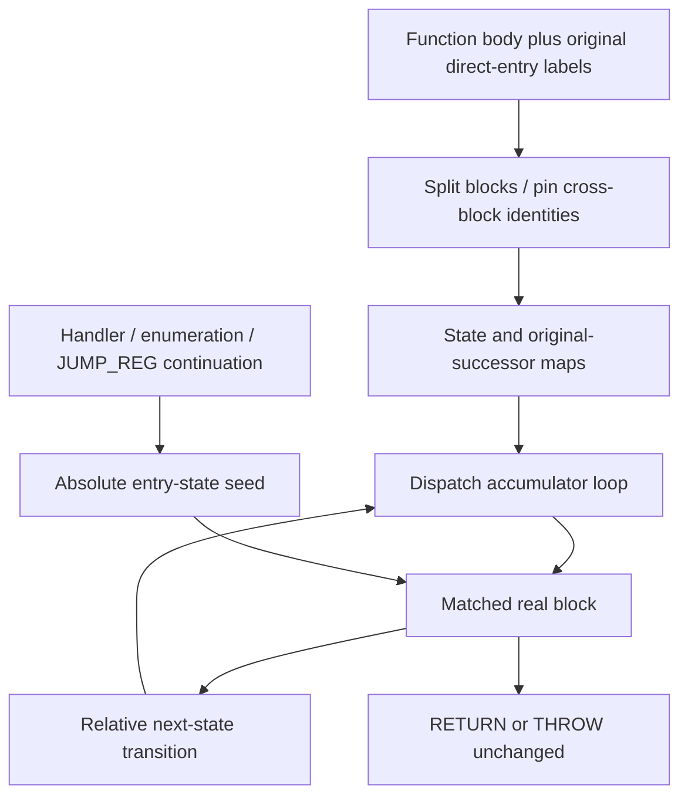

# State-based control-flow flattening

## 1. Target

Control-flow flattening replaces eligible per-function branches and fallthroughs with state
transitions through a virtual dispatch loop, then shuffles block placement and adds unreachable
state arms. Ordinary branches retain their intended destinations through state matching rather
than physical adjacency. This page specifies the pinned producer and its execution through
canonical instructions, including exception/continuation entries that bypass dispatch. It does
not promise arbitrary hand-built IR or complete generated-option qualification.

Readers need control-flow blocks, registers, labels and function frames. Read the
[package prerequisites](../js-confuser-vm.md#prerequisites-and-scope),
[shared helper assembly](../symbolic-helper-assembly.md),
[register allocation](../container-wordcode.md#symbolic-operands-and-register-assignment) and
[canonical branch/completion semantics](../instruction-set.md#3-implementation). Raw while/
if/intrinsic lowering is supplied compiler infrastructure, not reconstructed here.

## 2. Algorithm

Partition the current program by function entries. A function with no JUMP/JUMP_IF_FALSE/
JUMP_IF_TRUE is unchanged. Split a candidate's body at labels and terminating instructions,
then subdivide large straight-line bodies. Assign distinct u16 states to blocks. Record original
successors before changing order, so fallthrough after a conditional or chunk boundary still
selects its original next block.

Construct a dispatch loop whose `state` starts at the original first block's state. An if-chain
compares state with a relative accumulator c. Start c at the first arm's state; add/subtract
successive arm differences. The telescoping sum makes each test's c equal that arm's state even
when arm order is shuffled. Matching arms jump directly to the block label. A distinct endState
is the loop condition sentinel, not a new VM halt operation.

After a block, route to the next state by adding/subtracting the difference from its current
state, then jump to loopTop. Replace ordinary conditional terminators with an inverted test and
two relative transitions, one for target and one for original fallthrough. RETURN/THROW stay
terminal. Shuffle physical blocks independently of the dispatch comparison order. Add 1..5 fake
blocks with distinct states that no real transition targets; fake transitions may target real
or fake states, but are not reached from the admitted real state graph.

Two state protections are consequential. First, registers observed in multiple blocks and all
dispatch-loop register occurrences are pinned for nonreused allocation: linear textual lifetimes
alone do not model backward dispatch edges. Second, labels referenced by nonterminator operands
can be entered without passing through the dispatch loop. Their blocks must assign state to their
own absolute state on entry before relative outgoing transitions. A catch/finalizer/continuation
entry otherwise inherits another block's state and computes the wrong next state.



This graph explains why seeding belongs at the direct-entry block, and why allocation protection
must happen before register resolution. The later
[branch dispatcher](encoded-branch-dispatch.md) can encode the newly emitted conditional branches;
CFF does not independently implement its branchless PC selection.

### Synthetic worked example and continuation control

Supply three original blocks A/B/C with states 10/40/20, endState 60 and one fake F with state
50. A terminates in JUMP_IF_FALSE condition,C; its original successor is B. B jumps to C;
C returns its result. Choose dispatch comparison order C,A,F,B and physical order B,F,C,A.
The accumulator sequence is `c=20; c-=10; c+=40; c-=10`, comparing state at each step to
20,10,50,40 and jumping respectively to C,A,F,B. Starting state is 10, independently of
physical first block B. CFF emits A's terminator as:

```text
explanatory symbolic route, state register q and scratch d:
JUMP_IF_TRUE condition, skip
LOAD_INT d,10; ADD q,q,d; JUMP loopTop    # 10 -> 20, false edge
defineLabel skip
LOAD_INT d,30; ADD q,q,d; JUMP loopTop    # 10 -> 40, true fallthrough
```

B emits `LOAD_INT d,20; SUB q,q,d; JUMP loopTop`, taking 40 -> 20. Thus false traces states
10,20; true traces 10,40,20; F's state is never selected by real transitions. A register read
in A and C is marked pinned on **every original occurrence**, regardless of shuffled position.
This example describes state/route semantics rather than an exact compiler-generated word array;
it omits real instruction bodies, raw dispatch lowering and physical register allocation.

For a separate direct-entry control, supply a nonterminator `LOAD_INT continuation,label(D)`
followed elsewhere by JUMP_REG continuation. D has state 20 and outgoing successor state 40.
Entering D while q still equals 10 must execute `LOAD_INT q,20` at D's entry, then delta +20
produces 40. Omitting the seed produces 30, matching no arm. The collection rule covers the
label operand without attempting whole-program indirect-jump analysis. FOR_IN_NEXT exits,
TRY_SETUP handlers and FINALLY_SETUP finalizer/throw-pad labels are analogous direct references.

## 3. Implementation

### Components and block representation

| Component | Input -> output | Consumer dependency |
|---|---|---|
| Eligibility/direct-entry collector | Original per-function body -> gate/label Set | Collect before branch replacement; nonterminator labels need entry seed. |
| Splitter/state allocator | Body -> ordered blocks | Preserve first chunk's label/state and original successor sequence. |
| Lifetime protector | Bodies/terminators -> pinned occurrences | First emitted occurrence must carry the required pin; later metadata cannot change the recorded pool. |
| Dispatch assembler | Real/fake states -> inline loop/state register/top-exit labels | Supplied lowering emits intrinsic JUMPs and recognizable while labels. |
| Successor recorder | Unshuffled block sequence -> label/state and fallthrough maps | Stamp originalIndex before physical shuffle. |
| Emitter | Maps/loop/blocks -> shuffled IR | Relative transitions assume own state on entry; seeded direct entries restore it. |

A block has `label`, `body`, `terminator|null`, `stateValue`, `originalNextIndex`, then
`originalIndex`; fake blocks additionally have `isFake:true`. States are integers 0..65535.
Distinctness uses redraw-until-unused, without a bounded attempt count or capacity check.

### Split, gate and direct entries

Use the [function partitioner](../symbolic-helper-assembly.md#exact-shared-register-and-partition-operations).
Candidate gate tests only for any of the three ordinary branch opcodes, not label validity.
Before splitting, collect all operands of type label from nonnull instructions **except**
JUMP/JUMP_IF_FALSE/JUMP_IF_TRUE/RETURN/THROW. These five opcodes are terminators. The collection
is deliberately broader than the named continuation operations; MAKE_CLOSURE labels are collected
too, but generally do not name a block in the current function. It does not follow JUMP_REG values.

Maintain currentLabel=null and currentBody=[]. At a defineLabel, flush a nonempty/labeled current
block with no terminator, then retain that label for the next block. At a terminator, flush with
that instruction, even if the body/label is empty. All other records append to body. Flush trailing
body/label. A flush with empty body, no label and no terminator emits nothing. New unlabeled blocks
receive `_makeLabel("cff_block")` and a freshly unused random state.

If body length exceeds 3 **instruction records**, divide into consecutive chunks of at most 3.
First chunk retains label/state; later chunks get `_makeLabel("cff_split")` and fresh states.
Only the final chunk retains the original terminator. Other chunks have null terminator. Count
includes non-label pseudo records; it is not a word-width limit. Set each block's originalNextIndex
to the next split block, or -1 for the last. If fewer than two blocks result, return original IR;
label/state allocation already performed during the attempted split is not rolled back.

### Allocation, fake states and dispatch construction

Scan every block body plus terminator, counting distinct block occurrences of `(fnId,id)` among
register operands. For identities appearing in multiple blocks, set `pinned=true` on all those
operand objects. The source comments mention deleting kind, but the actual implementation retains
kind/scope metadata and assigns pinned. The allocator records local:: only if the first emitted
occurrence of that identity is pinned (or is a plain local). Pinning all original block occurrences
protects that choice across block shuffle; later producers must preserve the needed first-occurrence
metadata, because later pins do not replace an already recorded pool.

Draw endState until distinct from real states. startState is the first split block's state. Draw
fakeCount 1..5; for each draw state distinct from all real/prior fake states and endState, assign
label hint chosen from cff_block/cff_split, empty body, null terminator, originalNextIndex=-1 and
isFake=true. Add each fake state to the used Set before the next draw.

Shuffle a copy of real-plus-fake blocks using descending Fisher-Yates with inclusive integer
0..i. Assemble this explanatory helper source algorithm, using numeric differences without wrap:

```text
state = startState; c = 0
while state !== endState:
  c = firstArm.state
  if state === c: intrinsicJump(firstArm.label)
  for each later arm:
    c += delta if delta >= 0, else c -= abs(delta)
    if state === c: intrinsicJump(arm.label)
```

Template compileInline supplies the exact raw-lowering boundary. Set pinned on **all register
operand occurrences** in its returned inline bytecode. Require its local map to contain state,
otherwise throw `CFF: Template did not produce a 'state' register`. Select the first defineLabels
whose strings contain `while_top` and `while_exit`; missing either throws
`CFF: Could not find while loop labels in Template output`. Return inline IR, state register,
top/exit labels and innerBytecode. loopExitLabel is identified but not used to synthesize a return
or route at the end of the emitted function. Allocate **one plain local rDelta per transformed
function**, reused across every real and fake transition. Each transition writes its magnitude
before reading it; fake-fork construction likewise initializes scratch before use. No per-edge
register is allocated.

### Exact real and fake emission

Before physical shuffle, build labelToState for every real/fake block, stamp originalIndex, and
map that index to the original successor state or endState if next=-1. Then shuffle blocks.
Emit the complete inline dispatch bytecode first, followed by each shuffled block's defineLabel.
For a real block whose label occurs in directEntryLabels, emit `LOAD_INT state,blockState` before
the body. A split block retains the original incoming label on its first chunk, which is the
point that needs the seed.

`transition(current,target)` emits `LOAD_INT rDelta,abs(target-current)`, then ADD state,state,
rDelta for nonnegative delta or SUB for negative delta, then JUMP loopTop. Delta zero still emits
the three instructions. With states in u16 range, magnitude is <=65535; runtime arithmetic is
ordinary Number arithmetic, not u16 wrapping. Fresh refs carry identity only.

| Original terminator | Emission decision |
|---|---|
| null | Transition to recorded original successor state, or endState. |
| RETURN/THROW | Emit original terminator unchanged. |
| JUMP label in labelToState | Transition to target state. |
| JUMP_IF_FALSE known label | Emit original condition object with inverted JUMP_IF_TRUE to fresh cff_skip; false target transition; skip marker; true successor transition. |
| JUMP_IF_TRUE known label | Same construction with inverted JUMP_IF_FALSE; true target transition; false successor transition. |
| Unknown/non-label ordinary branch | Emit original terminator unchanged, without compensating fallthrough route or new target validation. |

An unchanged conditional to an external/malformed target does not restore original physical
fallthrough after shuffle. The intended supplied lowering has internal symbolic branch labels;
arbitrary IR safety cannot be inferred from this fallback. An endState match exits the inline
while and falls into whatever appended block follows the loop; it does not terminate the frame.
Normal lowered bodies end via RETURN/THROW. No stronger end-state completion contract is asserted.

Fake emission has chance(50) of one transition from its state to a randomly chosen real/fake
state. Otherwise emit `LOAD_INT rDelta,random(0,65535)`, LT rDelta,state,rDelta and
JUMP_IF_TRUE rDelta,cff_skip; emit one randomly chosen transition, skip marker, then another
independent randomly chosen transition. Target universe excludes endState. Fake code is dead
under real-state routing; it is not a separately preserved original-program behavior.

### State and acceptance

Callbacks return new function IR plus dispatch innerBytecode as tail. Instruction bodies and
original condition/terminal objects may be reused while register pins mutate private input
occurrences. There is no rollback of label/descriptor/pin allocations after a later error or no-
op split. Public whole-source publication follows the container. Derived state here is symbolic
register metadata, block maps and appended descriptors; Babel scope caches are not consulted.

| Scenario | Observable result / oracle | Acceptance criterion | Evidence/control |
|---|---|---|---|
| C1 gate/split/chunks | Supplied labels/terminators/chunk record sequence | No ordinary branch inert; chunk bodies <=3; first labels preserved | [Frozen selected C1 splitter/gate](#fixtures); actual producer missing |
| C2 dispatch/transitions | Item 2 state traces and accumulator values | Both true/false edges reach original blocks despite independent shuffles | [Frozen selected C2 outgoing deltas](#fixtures); owner accumulator arithmetic separate; loop/runtime missing |
| C3 direct entries | D enters with stale state 10, seeded to 20, exits at 40 | Nonterminator label collection; seed before body/relative update | [Frozen selected C3 seed/no-seed](#fixtures) and owner oracle; actual handlers/finally missing |
| C4 lifetime metadata | Every cross-block/dispatch occurrence pin; physical slot map | No local:: reuse across backedges; condition object retains pin | [Frozen selected C4 occurrence pins](#fixtures); first-pool/physical/composed allocation missing |
| C5 fake/end/external limits | Fake states absent from real targets; literal fallback/loop exit | No false claim of halt or arbitrary external fallthrough preservation | Source boundary; direct private-edge controls missing |
| C6 combined branches | Later dispatcher encodes CFF and helper branches | State routing/PCs/pins/captures and behavior all agree | Source schedule; generated/composed evidence missing |

## 4. Later Stages

| Later stage | Consequence |
|---|---|
| Dispatcher | Sees emitted conditional tests/state jumps and earlier helper functions; original condition occurrence preserves CFF pinned metadata. |
| Pair expansion/augmentation | Dispatch helper constants get pairs; emitted branches/calls change added-opcode eligibility and final widths. |
| Register resolution | First-occurrence metadata selects the pool; all original cross-block/dispatch occurrences are pinned. One shared per-function scratch is a plain local. |
| Label resolution/PATCH | Shuffled blocks and helper tails acquire final absolute word PCs; state values remain distinct from PCs. |
| Runtime reshaping | Canonical operations execute the flattened loop; no CFF-specific runtime AST pass is installed. |

## 5. Known Quirks

State allocation has finite u16 capacity with unbounded collision retry and no exhaustion guard.
Candidate/split no-op can consume label/random state. Actual promotion uses pinned rather than
the older comment's kind deletion. Unknown branch fallback and endState loop exit have the
literal limitations above. This source recipe supplies no full raw lowering, actual finalizer/
capture state verification, arbitrary malformed-IR guarantee or generated-stack qualification.

## Source

All links name `20c5b96bf57337c568579352758d7685358650de`.
Terminator/direct-entry/split/protection are
[controlFlowFlattening.ts#L97-L313](https://github.com/MichaelXF/js-confuser-vm/blob/20c5b96bf57337c568579352758d7685358650de/src/transforms/bytecode/controlFlowFlattening.ts#L97-L313);
dispatch/transition/fakes are
[controlFlowFlattening.ts#L316-L540](https://github.com/MichaelXF/js-confuser-vm/blob/20c5b96bf57337c568579352758d7685358650de/src/transforms/bytecode/controlFlowFlattening.ts#L316-L540);
gate/mapping/shuffle/emission are
[controlFlowFlattening.ts#L542-L821](https://github.com/MichaelXF/js-confuser-vm/blob/20c5b96bf57337c568579352758d7685358650de/src/transforms/bytecode/controlFlowFlattening.ts#L542-L821).
Shared assembly is [template.ts#L194-L278](https://github.com/MichaelXF/js-confuser-vm/blob/20c5b96bf57337c568579352758d7685358650de/src/template.ts#L194-L278) and
[pass-utils.ts#L10-L126](https://github.com/MichaelXF/js-confuser-vm/blob/20c5b96bf57337c568579352758d7685358650de/src/utils/pass-utils.ts#L10-L126).
The ordered position in items 2/4 is
[compiler.ts#L3290-L3315](https://github.com/MichaelXF/js-confuser-vm/blob/20c5b96bf57337c568579352758d7685358650de/src/compiler.ts#L3290-L3315).
The first-occurrence pin/pool consumer is
[resolveRegisters.ts#L34-L101](https://github.com/MichaelXF/js-confuser-vm/blob/20c5b96bf57337c568579352758d7685358650de/src/transforms/bytecode/resolveRegisters.ts#L34-L101).
Runtime ordinary branches and indirect continuation are
[runtime.ts#L546-L563](https://github.com/MichaelXF/js-confuser-vm/blob/20c5b96bf57337c568579352758d7685358650de/src/runtime.ts#L546-L563) and
[runtime.ts#L894-L898](https://github.com/MichaelXF/js-confuser-vm/blob/20c5b96bf57337c568579352758d7685358650de/src/runtime.ts#L894-L898).

## Fixtures

No retained generated flattened program or direct actual producer/allocator/runtime fixture is
supplied here. The
[shared frozen-proof boundary](../symbolic-helper-assembly.md#frozen-selected-mechanics-proof-boundary)
owns protocol/manifest and common exclusions.

| Evidence | Scenario and selected assertion | Exclusion |
|---|---|---|
| Retired frozen verifier | C1-C4 selected no-branch gate/chunks/pins, both conditional outgoing deltas, direct-entry seed/no-seed consequence and named raw-loop metadata refusals | Supplied loop metadata/states/scalar route oracle; no whole CFF producer or actual allocator/runtime |
| Item 2 owner example | C2 accumulator/state traces and C3 seeded/unseeded transition | Source-informed arithmetic; independent cold subset does not test accumulator-loop execution |
| [controlFlowFlattening.test.js](https://github.com/MichaelXF/js-confuser-vm/blob/20c5b96bf57337c568579352758d7685358650de/test/options/controlFlowFlattening.test.js) | Upstream marker/branch-behavior test intent | No fresh execution |
| No actual integrated control | Dispatch loop/fakes/end-state, handler/finally/physical slots and C6 composition | Remain unverified |

Cross-block occurrence pins are observable in the reconstruction, but its scalar oracle does not
execute the real allocator or verify first-occurrence pool selection. One per-function scratch
register is a source-derived construction contract; outgoing-delta controls do not establish
exact allocation order/maxima. Raw loop metadata is supplied; accumulator/backedge loop, fake
state selection/emission, end-state completion and real handler/finalizer entry are excluded.
No complete producer, physical layout, actual helper/runtime or generated/composed admission is
credited. Named missing-state/loop-label controls concern the rebuilt metadata check, not fresh
observations of real encoder failure/publication.
